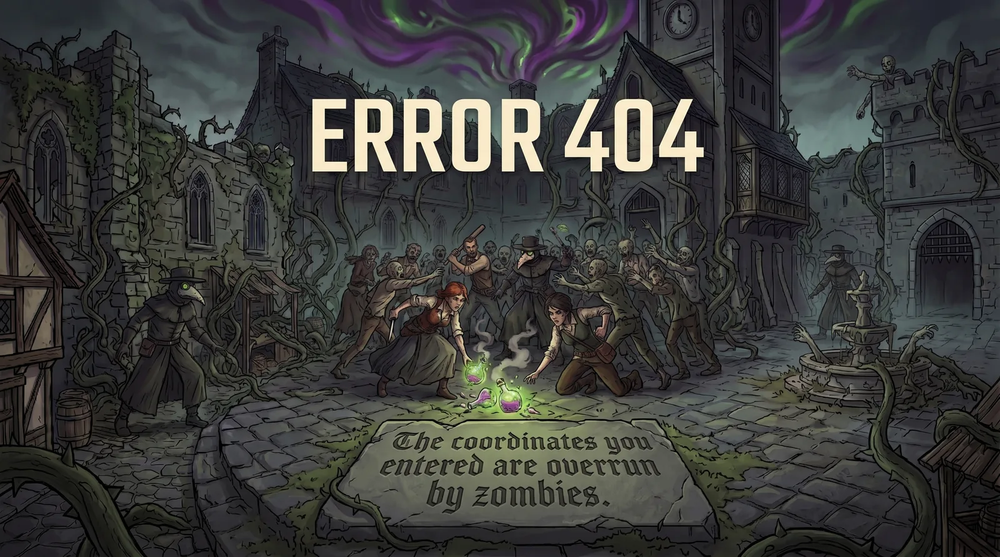

=== page--404 ===
---
layout: default
page_key: "404"
subtitle: "Area Overrun"
permalink: /404.html
---

<section class="content-pane" markdown="1" id="404">

[Return to the Main Hub](/{{ site.active_lang }}/index.html) before the horde arrives.
</section>
