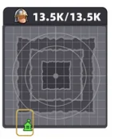
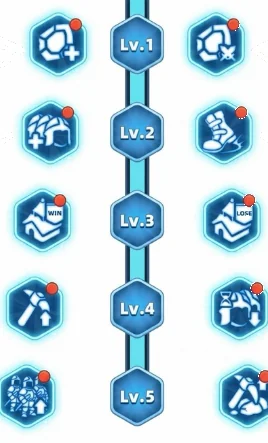
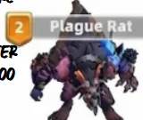
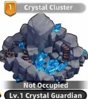
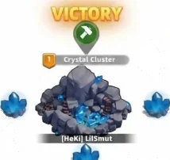
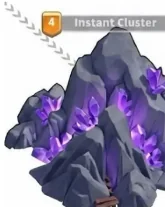
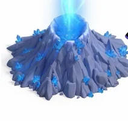
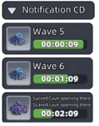

=== guide--en--events--crystal ===
---
layout: guides
title: "Crystal Cluster Valley"
subtitle: "Skills, clusters and how to win the crystals"
active_nav: guides
guide_id: "crystal"
nav_links:
  - name_key: "crystal_valley"
    url: "#valley"
  - name_key: "crystal_skills"
    url: "#skills"
  - name_key: "crystal_clusters"
    url: "#clusters"
  - name_key: "crystal_late"
    url: "#late"
  - name_key: "crystal_controls"
    url: "#controls"
---



<section class="content-pane" id="{{ pane.nav_id }}">
{{ pane.content }}
</section>



=== pane--en--events--crystal--01--valley ===
---
title: "The Valley"
nav_id: "valley"
parent_guide: "crystal"
lang: "en"
order: 1
---

Crystal Cluster Valley is a free-for-all: everyone gathers, steals and fights for crystals on one map.

* **The map is in rings.** Each square ring is one level: the lightest grey is level 1, then 2, then 3, then the centre.
* **The higher the level, the more crystals,** and the more competition for them.
* **The big crystal in the centre** (the Sacred Crystal Cluster) opens for the **last 7 minutes**.
* **Plague Rats** roam the map. Defeating them gives you skill crystals, which unlock your skills.

=== pane--en--events--crystal--02--skills ===
---
title: "Skills"
nav_id: "skills"
parent_guide: "crystal"
lang: "en"
order: 2
---

The skill tree has five levels, with a choice of two skills on each. Unlocking every level takes **2,300 skill crystals**. Pick by how you play: gathering or fighting.

#### Level 1

* **Left:** +1,080 crystals every so often.
* **Right:** +1,500 crystals for each rat you kill.
* **Pick:** right if you'll keep killing rats. Left if you'll stop once all your skills are unlocked.

#### Level 2

* **Left:** +50 march capacity for a single hero.
* **Right:** +25% march speed.
* **Pick:** right, for the speed advantage.

#### Level 3

* **Left:** +5,000 crystals when you **succeed** in seizing a cluster.
* **Right:** +5,000 crystals when you **fail** to seize a cluster.
* **Pick:** when you go to steal an occupied cluster, left if you're likely to win, right if you're likely to lose. It depends on whether you hit hard or take heavy hits.

#### Level 4

* **Left:** +15% gathering speed.
* **Right:** debuffs last 30 seconds less.
* **Pick:** left for gatherers, right for attackers.

#### Level 5

* **Left:** +15% hero damage for 60 seconds (300-second cooldown).
* **Right:** +50% gathering speed for 60 seconds (300-second cooldown).
* **Pick:** left for fighters, right for gatherers.

#### Getting skill crystals

Level up the skill tree by defeating Plague Rats:

* **Level 1 rat** (200K Might): 75 skill crystals.
* **Level 2 rat** (500K Might): 150 skill crystals.

=== pane--en--events--crystal--03--clusters ===
---
title: "Clusters"
nav_id: "clusters"
parent_guide: "crystal"
lang: "en"
order: 3
---

#### Crystal clusters

* A **Crystal Guardian** (level 1, 2 or 3) under a cluster means nobody has occupied it yet. When you reach it, **3 crystals pop out** that your scouts can gather.
* The higher the cluster's level, the more crystals it holds to gather, and the bigger its instant drop: **800 to 3,000 crystals** at once.
* Crystals also pop out around a cluster when it's taken. **Steal them, and be quick!**
* With the level 3 skill for a successful seize, knock someone off a cluster **once a minute** for 5,000 crystals.

#### Instant clusters

* **Go for these when there are no rats to kill.**
* If there are no rats and no Guardian crystals near you, teleport to an area that has them.

#### The Sacred Crystal Cluster

When the centre opens (the last 7 minutes): **teleport there, activate your +15% hero damage skill, and attack!**

=== pane--en--events--crystal--04--late ===
---
title: "Late Method"
nav_id: "late"
parent_guide: "crystal"
lang: "en"
order: 4
---

**Scotty's late method**, for players who fight:

1. **Enter the event 10–15 minutes late.**
2. **Take the fighting skills:** +1,500 crystals per rat kill, +25% march speed, +5,000 crystals for a successful seize, shorter debuffs, and +15% hero damage for 60 seconds.
3. **Kill as many Plague Rats as you can**: each one is worth 1,500 crystals with your level 1 skill.
4. **Knock players off clusters** once a minute for 5,000 crystals each time, and grab the crystals that pop out.
5. **No rats left?** Take the Instant Clusters, or teleport to where the Guardian crystals are.
6. **When the centre opens,** teleport there, activate +15% hero damage and attack.

=== pane--en--events--crystal--05--controls ===
---
title: "Controls"
nav_id: "controls"
parent_guide: "crystal"
lang: "en"
order: 5
---

#### Teleport

You get **1 free teleport every 5 minutes**. The countdown under the button shows when the next one is ready.

#### Notification timers

The timers show when the next Instant Clusters will appear, and when the centre opens.

#### Skill button

The level 5 skill is **not passive**: tap this symbol, then tap **Activate**.

=== guide--de--events--crystal ===
---
layout: guides
title: "Kristalltal"
subtitle: "Fähigkeiten, Cluster und wie man die Kristalle gewinnt"
active_nav: guides
guide_id: "crystal"
nav_links:
  - name_key: "crystal_valley"
    url: "#valley"
  - name_key: "crystal_skills"
    url: "#skills"
  - name_key: "crystal_clusters"
    url: "#clusters"
  - name_key: "crystal_late"
    url: "#late"
  - name_key: "crystal_controls"
    url: "#controls"
---



<section class="content-pane" id="{{ pane.nav_id }}">
{{ pane.content }}
</section>



=== pane--de--events--crystal--01--valley ===
---
title: "Das Tal"
nav_id: "valley"
parent_guide: "crystal"
lang: "de"
order: 1
---

Das Kristalltal ist ein „Jeder gegen Jeden“: Alle sammeln, stehlen und kämpfen auf einer Karte um Kristalle.

* **Die Karte ist in Ringe unterteilt.** Jeder quadratische Ring entspricht einer Stufe: Das hellste Grau ist Stufe 1, dann 2, dann 3, gefolgt vom Zentrum.
* **Je höher die Stufe, desto mehr Kristalle** gibt es und desto größer ist der Wettbewerb darum.
* **Der große Kristall im Zentrum** (das Heilige Kristallcluster) öffnet sich für die **letzten 7 Minuten**.
* **Seuchenratten** streifen über die Karte. Wenn du sie besiegst, erhältst du Fähigkeitskristalle, mit denen du deine Fähigkeiten freischaltest.

=== pane--de--events--crystal--02--skills ===
---
title: "Fähigkeiten"
nav_id: "skills"
parent_guide: "crystal"
lang: "de"
order: 2
---

Der Fähigkeitenbaum hat fünf Stufen, mit jeweils zwei Fähigkeiten zur Auswahl. Das Freischalten aller Stufen kostet **2.300 Fähigkeitskristalle**. Wähle entsprechend deiner Spielweise: Sammeln oder Kämpfen.

#### Stufe 1

* **Links:** +1.080 Kristalle in regelmäßigen Abständen.
* **Rechts:** +1.500 Kristalle für jede getötete Ratte.
* **Wahl:** Rechts, wenn du weiterhin Ratten töten willst. Links, wenn du aufhörst, sobald alle deine Fähigkeiten freigeschaltet sind.

#### Stufe 2

* **Links:** +50 Marschkapazität für einen einzelnen Helden.
* **Rechts:** +25% Marschgeschwindigkeit.
* **Wahl:** Rechts für den Geschwindigkeitsvorteil.

#### Stufe 3

* **Links:** +5.000 Kristalle, wenn du **erfolgreich** ein Cluster einnimmst.
* **Rechts:** +5.000 Kristalle, wenn du **daran scheiterst**, ein Cluster einzunehmen.
* **Wahl:** Wenn du versuchst, ein besetztes Cluster zu stehlen, wähle Links, wenn du wahrscheinlich gewinnst, und Rechts, wenn du wahrscheinlich verlierst. Es hängt davon ab, ob du stark zuschlägst oder schwere Treffer einstecken musst.

#### Stufe 4

* **Links:** +15% Sammelgeschwindigkeit.
* **Rechts:** Debuffs halten 30 Sekunden kürzer an.
* **Wahl:** Links für Sammler, Rechts für Angreifer.

#### Stufe 5

* **Links:** +15% Heldenschaden für 60 Sekunden (300 Sekunden Abklingzeit).
* **Rechts:** +50% Sammelgeschwindigkeit für 60 Sekunden (300 Sekunden Abklingzeit).
* **Wahl:** Links für Kämpfer, Rechts für Sammler.

#### Fähigkeitskristalle erhalten

Steige im Fähigkeitenbaum auf, indem du Seuchenratten besiegst:

* **Ratte Stufe 1** (200K Macht): 75 Fähigkeitskristalle.
* **Ratte Stufe 2** (500K Macht): 150 Fähigkeitskristalle.

=== pane--de--events--crystal--03--clusters ===
---
title: "Cluster"
nav_id: "clusters"
parent_guide: "crystal"
lang: "de"
order: 3
---

#### Kristallcluster

* Ein **Kristallwächter** (Stufe 1, 2 oder 3) unter einem Cluster bedeutet, dass es noch niemand besetzt hat. Wenn du es erreichst, **springen 3 Kristalle heraus**, die deine Späher sammeln können.
* Je höher die Stufe des Clusters, desto mehr Kristalle enthält es zum Sammeln und desto größer ist der Sofort-Drop: **800 bis 3.000 Kristalle** auf einmal.
* Kristalle springen auch um ein Cluster herum, wenn es eingenommen wird. **Stehle sie und sei schnell!**
* Mit der Stufe-3-Fähigkeit für eine erfolgreiche Einnahme kannst du jemanden **einmal pro Minute** von einem Cluster vertreiben, um 5.000 Kristalle zu erhalten.

#### Sofort-Cluster

* **Gehe zu diesen, wenn es keine Ratten mehr zu töten gibt.**
* Wenn keine Ratten und keine Wächterkristalle in deiner Nähe sind, teleportiere dich in ein Gebiet, in dem es welche gibt.

#### Das Heilige Kristallcluster

Wenn sich das Zentrum öffnet (die letzten 7 Minuten): **Teleportiere dich dorthin, aktiviere deine +15% Heldenschaden-Fähigkeit und greife an!**

=== pane--de--events--crystal--04--late ===
---
title: "Späte Methode"
nav_id: "late"
parent_guide: "crystal"
lang: "de"
order: 4
---

**Scottys späte Methode** für Spieler, die kämpfen:

1. **Betritt das Event 10–15 Minuten später.**
2. **Wähle die Kampffähigkeiten:** +1.500 Kristalle pro getöteter Ratte, +25% Marschgeschwindigkeit, +5.000 Kristalle für eine erfolgreiche Einnahme, kürzere Debuffs und +15% Heldenschaden für 60 Sekunden.
3. **Töte so viele Seuchenratten wie möglich:** Jede ist mit deiner Stufe-1-Fähigkeit 1.500 Kristalle wert.
4. **Vertreibe Spieler von Clustern** einmal pro Minute für jeweils 5.000 Kristalle und schnappe dir die Kristalle, die herausspringen.
5. **Keine Ratten mehr übrig?** Nimm die Sofort-Cluster oder teleportiere dich dorthin, wo es Wächterkristalle gibt.
6. **Wenn sich das Zentrum öffnet,** teleportiere dich dorthin, aktiviere +15% Heldenschaden und greife an.

=== pane--de--events--crystal--05--controls ===
---
title: "Steuerung"
nav_id: "controls"
parent_guide: "crystal"
lang: "de"
order: 5
---

#### Teleport

Du erhältst **alle 5 Minuten 1 kostenlosen Teleport**. Der Countdown unter dem Button zeigt an, wann der nächste bereit ist.

#### Benachrichtigungs-Timer

Die Timer zeigen an, wann die nächsten Sofort-Cluster erscheinen und wann sich das Zentrum öffnet.

#### Fähigkeits-Button

Die Fähigkeit der Stufe 5 ist **nicht passiv**: Tippe auf dieses Symbol und dann auf **Aktivieren**.

=== guide--es--events--crystal ===
---
layout: guides
title: "Valle de los Racimos de Cristal"
subtitle: "Habilidades, racimos y cómo ganar cristales"
active_nav: guides
guide_id: "crystal"
nav_links:
  - name_key: "crystal_valley"
    url: "#valley"
  - name_key: "crystal_skills"
    url: "#skills"
  - name_key: "crystal_clusters"
    url: "#clusters"
  - name_key: "crystal_late"
    url: "#late"
  - name_key: "crystal_controls"
    url: "#controls"
---



<section class="content-pane" id="{{ pane.nav_id }}">
{{ pane.content }}
</section>



=== pane--es--events--crystal--01--valley ===
---
title: "El Valle"
nav_id: "valley"
parent_guide: "crystal"
lang: "es"
order: 1
---

El Valle de los Racimos de Cristal es un todos contra todos: todos recolectan, roban y luchan por cristales en un mismo mapa.

* **El mapa está dividido en anillos.** Cada anillo cuadrado es un nivel: el gris más claro es el nivel 1, luego el 2, el 3 y finalmente el centro.
* **Cuanto más alto sea el nivel, más cristales habrá,** y mayor será la competencia por ellos.
* **El gran cristal del centro** (el Racimo de Cristal Sagrado) se abre durante los **últimos 7 minutos**.
* **Las Ratas de la Plaga** deambulan por el mapa. Derrotarlas te da cristales de habilidad, que desbloquean tus habilidades.

=== pane--es--events--crystal--02--skills ===
---
title: "Habilidades"
nav_id: "skills"
parent_guide: "crystal"
lang: "es"
order: 2
---

El árbol de habilidades tiene cinco niveles, con dos habilidades a elegir en cada uno. Desbloquear todos los niveles requiere **2,300 cristales de habilidad**. Elige según tu forma de jugar: recolectando o luchando.

#### Nivel 1

* **Izquierda:** +1,080 cristales cada cierto tiempo.
* **Derecha:** +1,500 cristales por cada rata que elimines.
* **Elección:** Derecha si seguirás matando ratas. Izquierda si dejarás de hacerlo una vez que todas tus habilidades estén desbloqueadas.

#### Nivel 2

* **Izquierda:** +50 de capacidad de marcha para un solo héroe.
* **Derecha:** +25% de velocidad de marcha.
* **Elección:** Derecha, por la ventaja de velocidad.

#### Nivel 3

* **Izquierda:** +5,000 cristales cuando **tienes éxito** al tomar un racimo.
* **Derecha:** +5,000 cristales cuando **fallas** al intentar tomar un racimo.
* **Elección:** Cuando vayas a robar un racimo ocupado, izquierda si es probable que ganes, derecha si es probable que pierdas. Depende de si golpeas fuerte o recibes golpes fuertes.

#### Nivel 4

* **Izquierda:** +15% de velocidad de recolección.
* **Derecha:** los efectos negativos duran 30 segundos menos.
* **Elección:** Izquierda para recolectores, derecha para atacantes.

#### Nivel 5

* **Izquierda:** +15% de daño de héroe durante 60 segundos (enfriamiento de 300 segundos).
* **Derecha:** +50% de velocidad de recolección durante 60 segundos (enfriamiento de 300 segundos).
* **Elección:** Izquierda para luchadores, derecha para recolectores.

#### Cómo obtener cristales de habilidad

Sube de nivel el árbol de habilidades derrotando Ratas de la Plaga:

* **Rata de nivel 1** (200K de Poder): 75 cristales de habilidad.
* **Rata de nivel 2** (500K de Poder): 150 cristales de habilidad.

=== pane--es--events--crystal--03--clusters ===
---
title: "Racimos"
nav_id: "clusters"
parent_guide: "crystal"
lang: "es"
order: 3
---

#### Racimos de cristal

* Un **Guardián de Cristal** (nivel 1, 2 o 3) bajo un racimo significa que nadie lo ha ocupado todavía. Cuando llegues, **aparecerán 3 cristales** que tus exploradores pueden recoger.
* Cuanto mayor sea el nivel del racimo, más cristales tendrá para recoger y mayor será su botín instantáneo: **de 800 a 3,000 cristales** de golpe.
* También aparecen cristales alrededor de un racimo cuando es tomado. **¡Róbalos y sé rápido!**
* Con la habilidad de nivel 3 para capturas exitosas, saca a alguien de un racimo **una vez por minuto** para obtener 5,000 cristales.

#### Racimos instantáneos

* **Ve a por ellos cuando no haya ratas que matar.**
* Si no hay ratas ni cristales de Guardián cerca de ti, teletranspórtate a un área que los tenga.

#### El Racimo de Cristal Sagrado

Cuando el centro se abre (los últimos 7 minutos): **teletranspórtate allí, activa tu habilidad de +15% de daño de héroe y ataca.**

=== pane--es--events--crystal--04--late ===
---
title: "Método Tardío"
nav_id: "late"
parent_guide: "crystal"
lang: "es"
order: 4
---

**El método tardío de Scotty**, para jugadores que luchan:

1. **Entra al evento 10-15 minutos tarde.**
2. **Toma las habilidades de lucha:** +1,500 cristales por cada rata asesinada, +25% de velocidad de marcha, +5,000 cristales por una captura exitosa, efectos negativos más cortos y +15% de daño de héroe durante 60 segundos.
3. **Mata tantas Ratas de la Plaga como puedas:** cada una vale 1,500 cristales con tu habilidad de nivel 1.
4. **Saca a los jugadores de los racimos** una vez por minuto para obtener 5,000 cristales cada vez, y agarra los cristales que salgan.
5. **¿No quedan ratas?** Toma los Racimos Instantáneos o teletranspórtate a donde estén los cristales de Guardián.
6. **Cuando se abra el centro,** teletranspórtate allí, activa el +15% de daño de héroe y ataca.

=== pane--es--events--crystal--05--controls ===
---
title: "Controles"
nav_id: "controls"
parent_guide: "crystal"
lang: "es"
order: 5
---

#### Teletransporte

Obtienes **1 teletransporte gratis cada 5 minutos**. La cuenta atrás debajo del botón muestra cuándo estará listo el siguiente.

#### Temporizadores de notificaciones

Los temporizadores muestran cuándo aparecerán los próximos Racimos Instantáneos y cuándo se abre el centro.

#### Botón de habilidad

La habilidad de nivel 5 **no es pasiva**: toca este símbolo y luego toca **Activar**.

=== guide--fr--events--crystal ===
---
layout: guides
title: "Vallée des amas de cristal"
subtitle: "Compétences, amas et comment remporter les cristaux"
active_nav: guides
guide_id: "crystal"
nav_links:
  - name_key: "crystal_valley"
    url: "#valley"
  - name_key: "crystal_skills"
    url: "#skills"
  - name_key: "crystal_clusters"
    url: "#clusters"
  - name_key: "crystal_late"
    url: "#late"
  - name_key: "crystal_controls"
    url: "#controls"
---



<section class="content-pane" id="{{ pane.nav_id }}">
{{ pane.content }}
</section>



=== pane--fr--events--crystal--01--valley ===
---
title: "La Vallée"
nav_id: "valley"
parent_guide: "crystal"
lang: "fr"
order: 1
---

La Vallée des amas de cristal est un chacun pour soi : tout le monde rassemble, vole et se bat pour des cristaux sur une même carte.

* **La carte est divisée en anneaux.** Chaque anneau carré représente un niveau : le gris le plus clair est le niveau 1, puis 2, 3, et enfin le centre.
* **Plus le niveau est élevé, plus il y a de cristaux,** et plus la concurrence est rude.
* **Le gros cristal au centre** (l'Amas de cristal sacré) s'ouvre pendant les **7 dernières minutes**.
* **Des Rats de la peste** parcourent la carte. Les vaincre vous donne des cristaux de compétence, qui débloquent vos aptitudes.

=== pane--fr--events--crystal--02--skills ===
---
title: "Compétences"
nav_id: "skills"
parent_guide: "crystal"
lang: "fr"
order: 2
---

L'arbre de compétences comporte cinq niveaux, avec un choix entre deux compétences à chaque palier. Débloquer tous les niveaux coûte **2 300 cristaux de compétence**. Choisissez en fonction de votre style : récolte ou combat.

#### Niveau 1

* **Gauche :** +1 080 cristaux de temps en temps.
* **Droite :** +1 500 cristaux pour chaque rat tué.
* **Choix :** à droite si vous continuez à tuer des rats. À gauche si vous préférez arrêter une fois toutes vos compétences débloquées.

#### Niveau 2

* **Gauche :** +50 de capacité de marche pour un seul héros.
* **Droite :** +25 % de vitesse de marche.
* **Choix :** à droite, pour l'avantage de vitesse.

#### Niveau 3

* **Gauche :** +5 000 cristaux lorsque vous **réussissez** à saisir un amas.
* **Droite :** +5 000 cristaux lorsque vous **échouez** à saisir un amas.
* **Choix :** si vous allez voler un amas occupé, à gauche si vous êtes susceptible de gagner, à droite si vous risquez de perdre. Cela dépend de votre force de frappe.

#### Niveau 4

* **Gauche :** +15 % de vitesse de récolte.
* **Droite :** les affaiblissements durent 30 secondes de moins.
* **Choix :** à gauche pour les récolteurs, à droite pour les attaquants.

#### Niveau 5

* **Gauche :** +15 % de dégâts de héros pendant 60 secondes (recharge de 300 secondes).
* **Droite :** +50 % de vitesse de récolte pendant 60 secondes (recharge de 300 secondes).
* **Choix :** à gauche pour les combattants, à droite pour les récolteurs.

#### Obtenir des cristaux de compétence

Faites progresser l'arbre de compétences en vainquant des Rats de la peste :

* **Rat de niveau 1** (200K de Puissance) : 75 cristaux de compétence.
* **Rat de niveau 2** (500K de Puissance) : 150 cristaux de compétence.

=== pane--fr--events--crystal--03--clusters ===
---
title: "Amas"
nav_id: "clusters"
parent_guide: "crystal"
lang: "fr"
order: 3
---

#### Amas de cristal

* Un **Gardien de cristal** (niveau 1, 2 ou 3) sous un amas signifie que personne ne l'a encore occupé. Lorsque vous l'atteignez, **3 cristaux apparaissent** et peuvent être récoltés par vos éclaireurs.
* Plus le niveau de l'amas est élevé, plus il contient de cristaux, et plus son gain immédiat est important : **de 800 à 3 000 cristaux** instantanément.
* Des cristaux apparaissent également autour d'un amas lorsqu'il est pris. **Volez-les, et faites vite !**
* Avec la compétence de niveau 3 pour une saisie réussie, éjectez quelqu'un d'un amas **une fois par minute** pour obtenir 5 000 cristaux.

#### Amas instantanés

* **Visez-les lorsqu'il n'y a plus de rats à tuer.**
* S'il n'y a pas de rats ni de cristaux de Gardien près de vous, téléportez-vous vers une zone où il y en a.

#### L'Amas de cristal sacré

Lorsque le centre s'ouvre (les 7 dernières minutes) : **téléportez-vous là-bas, activez votre compétence +15 % de dégâts de héros, et attaquez !**

=== pane--fr--events--crystal--04--late ===
---
title: "Méthode tardive"
nav_id: "late"
parent_guide: "crystal"
lang: "fr"
order: 4
---

**La méthode tardive de Scotty**, pour les joueurs qui privilégient le combat :

1. **Rejoignez l'événement avec 10 à 15 minutes de retard.**
2. **Prenez les compétences de combat :** +1 500 cristaux par rat tué, +25 % de vitesse de marche, +5 000 cristaux pour une saisie réussie, affaiblissements plus courts, et +15 % de dégâts de héros pendant 60 secondes.
3. **Tuez autant de Rats de la peste que possible** : chacun vaut 1 500 cristaux avec votre compétence de niveau 1.
4. **Éjectez les joueurs des amas** une fois par minute pour obtenir 5 000 cristaux à chaque fois, et ramassez les cristaux qui apparaissent.
5. **Plus de rats ?** Visez les Amas instantanés ou téléportez-vous là où se trouvent les cristaux des Gardiens.
6. **Quand le centre s'ouvre,** téléportez-vous, activez les +15 % de dégâts de héros et attaquez.

=== pane--fr--events--crystal--05--controls ===
---
title: "Commandes"
nav_id: "controls"
parent_guide: "crystal"
lang: "fr"
order: 5
---

#### Téléportation

Vous obtenez **1 téléportation gratuite toutes les 5 minutes**. Le compte à rebours sous le bouton indique quand la prochaine sera prête.

#### Minuteurs de notification

Les minuteurs indiquent quand les prochains Amas instantanés apparaîtront, et quand le centre s'ouvrira.

#### Bouton de compétence

La compétence de niveau 5 n'est **pas passive** : appuyez sur ce symbole, puis appuyez sur **Activer**.

=== guide--ru--events--crystal ===
---
layout: guides
title: "Кристальная Долина"
subtitle: "Навыки, скопления и как получить кристаллы"
active_nav: guides
guide_id: "crystal"
nav_links:
  - name_key: "crystal_valley"
    url: "#valley"
  - name_key: "crystal_skills"
    url: "#skills"
  - name_key: "crystal_clusters"
    url: "#clusters"
  - name_key: "crystal_late"
    url: "#late"
  - name_key: "crystal_controls"
    url: "#controls"
---



<section class="content-pane" id="{{ pane.nav_id }}">
{{ pane.content }}
</section>



=== pane--ru--events--crystal--01--valley ===
---
title: "Долина"
nav_id: "valley"
parent_guide: "crystal"
lang: "ru"
order: 1
---

Кристальная Долина — это режим «каждый сам за себя»: все собирают, крадут и сражаются за кристаллы на одной карте.

* **Карта поделена на кольца.** Каждое квадратное кольцо — это уровень: самый светлый серый — 1-й уровень, затем 2-й, 3-й и центр.
* **Чем выше уровень, тем больше кристаллов** и тем выше конкуренция за них.
* **Большой кристалл в центре** (Священное Кристальное Скопление) открывается на **последние 7 минут**.
* **Чумные крысы** бродят по карте. Победа над ними дает вам кристальные навыки, которые открывают доступ к способностям.

=== pane--ru--events--crystal--02--skills ===
---
title: "Навыки"
nav_id: "skills"
parent_guide: "crystal"
lang: "ru"
order: 2
---

Дерево навыков состоит из пяти уровней, на каждом из которых можно выбрать один из двух навыков. На разблокировку всех уровней требуется **2 300 кристальных навыков**. Выбирайте в зависимости от своего стиля игры: сбор или бой.

#### Уровень 1

* **Слева:** +1 080 кристаллов через определенные промежутки времени.
* **Справа:** +1 500 кристаллов за каждую убитую крысу.
* **Выбор:** справа, если вы планируете продолжать убивать крыс. Слева, если вы перестанете это делать после открытия всех навыков.

#### Уровень 2

* **Слева:** +50 к вместимости марша для одного героя.
* **Справа:** +25% к скорости марша.
* **Выбор:** справа, ради преимущества в скорости.

#### Уровень 3

* **Слева:** +5 000 кристаллов при **успешном** захвате скопления.
* **Справа:** +5 000 кристаллов при **неудачном** захвате скопления.
* **Выбор:** при попытке украсть занятое скопление: левый, если вы, скорее всего, победите, правый — если скорее проиграете. Зависит от того, насколько сильны ваши атаки или насколько тяжелый урон вы получаете.

#### Уровень 4

* **Слева:** +15% к скорости сбора.
* **Справа:** действие ослаблений сокращается на 30 секунд.
* **Выбор:** слева для сборщиков, справа для атакующих.

#### Уровень 5

* **Слева:** +15% к урону героя на 60 секунд (перезарядка 300 секунд).
* **Справа:** +50% к скорости сбора на 60 секунд (перезарядка 300 секунд).
* **Выбор:** слева для бойцов, справа для сборщиков.

#### Получение кристальных навыков

Прокачивайте дерево навыков, побеждая Чумных крыс:

* **Крыса 1-го уровня** (200 тыс. мощи): 75 кристальных навыков.
* **Крыса 2-го уровня** (500 тыс. мощи): 150 кристальных навыков.

=== pane--ru--events--crystal--03--clusters ===
---
title: "Скопления"
nav_id: "clusters"
parent_guide: "crystal"
lang: "ru"
order: 3
---

#### Кристальные скопления

* Если под скоплением находится **Кристальный страж** (1, 2 или 3 уровня), значит, его еще никто не занял. Когда вы доберетесь до него, **выпадут 3 кристалла**, которые могут собрать ваши разведчики.
* Чем выше уровень скопления, тем больше кристаллов для сбора оно содержит и тем больше его мгновенный выпад: **от 800 до 3 000 кристаллов** за раз.
* Кристаллы также выпадают вокруг скопления, когда его захватывают. **Крадите их и делайте это быстро!**
* С навыком 3-го уровня на успешный захват выбивайте игроков из скопления **раз в минуту**, чтобы получать по 5 000 кристаллов.

#### Мгновенные скопления

* **Отправляйтесь к ним, если нет крыс для убийства.**
* Если рядом с вами нет крыс и кристальных стражей, телепортируйтесь в область, где они есть.

#### Священное Кристальное Скопление

Когда открывается центр (последние 7 минут): **телепортируйтесь туда, активируйте навык +15% к урону героя и атакуйте!**

=== pane--ru--events--crystal--04--late ===
---
title: "Метод позднего входа"
nav_id: "late"
parent_guide: "crystal"
lang: "ru"
order: 4
---

**Метод позднего входа от Scotty** для тех, кто предпочитает сражаться:

1. **Заходите в событие с опозданием на 10–15 минут.**
2. **Берите боевые навыки:** +1 500 кристаллов за убийство крысы, +25% к скорости марша, +5 000 кристаллов за успешный захват, сокращение времени действия ослаблений и +15% к урону героя на 60 секунд.
3. **Убивайте как можно больше Чумных крыс**: каждая из них стоит 1 500 кристаллов благодаря навыку 1-го уровня.
4. **Выбивайте игроков из скоплений** раз в минуту, получая по 5 000 кристаллов каждый раз, и подбирайте выпавшие кристаллы.
5. **Крыс не осталось?** Занимайте Мгновенные скопления или телепортируйтесь туда, где есть Кристальные стражи.
6. **Когда открывается центр,** телепортируйтесь туда, активируйте бонус +15% к урону героя и атакуйте.

=== pane--ru--events--crystal--05--controls ===
---
title: "Управление"
nav_id: "controls"
parent_guide: "crystal"
lang: "ru"
order: 5
---

#### Телепорт

Вы получаете **1 бесплатный телепорт каждые 5 минут**. Таймер под кнопкой показывает, когда будет доступен следующий.

#### Уведомления и таймеры

Таймеры показывают, когда появятся следующие Мгновенные скопления и когда откроется центр.

#### Кнопка навыка

Навык 5-го уровня **не является пассивным**: нажмите на этот символ, а затем нажмите **Активировать**.

=== guide--tr--events--crystal ===
---
layout: guides
title: "Kristal Kümesi Vadisi"
subtitle: "Yetenekler, kümeler ve kristaller nasıl kazanılır"
active_nav: guides
guide_id: "crystal"
nav_links:
  - name_key: "crystal_valley"
    url: "#valley"
  - name_key: "crystal_skills"
    url: "#skills"
  - name_key: "crystal_clusters"
    url: "#clusters"
  - name_key: "crystal_late"
    url: "#late"
  - name_key: "crystal_controls"
    url: "#controls"
---



<section class="content-pane" id="{{ pane.nav_id }}">
{{ pane.content }}
</section>



=== pane--tr--events--crystal--01--valley ===
---
title: "Vadi"
nav_id: "valley"
parent_guide: "crystal"
lang: "tr"
order: 1
---

Kristal Kümesi Vadisi, herkesin tek bir harita üzerinde kristaller topladığı, çaldığı ve onlar için savaştığı bir herkes tek (free-for-all) etkinliğidir.

* **Harita halkalar halindedir.** Her kare halka bir seviyedir: en açık gri 1. seviyedir, ardından 2, 3 ve merkez gelir.
* **Seviye ne kadar yüksekse, o kadar çok kristal vardır** ve rekabet de o kadar fazladır.
* **Merkezdeki büyük kristal** (Kutsal Kristal Kümesi), **son 7 dakika** kala açılır.
* **Veba Fareleri** haritada dolaşır. Onları yenmek size yetenek kristallerini verir, bu da yeteneklerinizin kilidini açar.

=== pane--tr--events--crystal--02--skills ===
---
title: "Yetenekler"
nav_id: "skills"
parent_guide: "crystal"
lang: "tr"
order: 2
---

Yetenek ağacı beş seviyeden oluşur ve her birinde iki yetenek seçeneği bulunur. Her seviyenin kilidini açmak **2.300 yetenek kristali** gerektirir. Oyun tarzınıza göre seçim yapın: toplama veya savaşma.

#### 1. Seviye

* **Sol:** Belirli aralıklarla +1.080 kristal.
* **Sağ:** Öldürdüğünüz her fare için +1.500 kristal.
* **Seçim:** Fareleri öldürmeye devam edecekseniz sağ tarafı seçin. Tüm yeteneklerinizin kilidi açıldıktan sonra duracaksanız sol tarafı seçin.

#### 2. Seviye

* **Sol:** Tek bir kahraman için +50 birlik kapasitesi.
* **Sağ:** +%25 yürüyüş hızı.
* **Seçim:** Hız avantajı için sağ tarafı seçin.

#### 3. Seviye

* **Sol:** Bir kümeyi ele almada **başarılı** olduğunuzda +5.000 kristal.
* **Sağ:** Bir kümeyi ele almada **başarısız** olduğunuzda +5.000 kristal.
* **Seçim:** Dolu bir kümeyi çalmaya gittiğinizde, kazanma ihtimaliniz yüksekse solu, kaybetme ihtimaliniz yüksekse sağı seçin. Bu, sert vuruş yapıp yapmadığınıza veya ağır darbeler alıp almadığınıza bağlıdır.

#### 4. Seviye

* **Sol:** +%15 toplama hızı.
* **Sağ:** Zayıflatıcılar 30 saniye daha kısa sürer.
* **Seçim:** Toplayıcılar için sol tarafı, saldırganlar için sağ tarafı seçin.

#### 5. Seviye

* **Sol:** 60 saniyeliğine +%15 kahraman hasarı (300 saniye bekleme süresi).
* **Sağ:** 60 saniyeliğine +%50 toplama hızı (300 saniye bekleme süresi).
* **Seçim:** Savaşçılar için sol tarafı, toplayıcılar için sağ tarafı seçin.

#### Yetenek kristalleri elde etme

Veba Farelerini yenerek yetenek ağacında seviye atlayın:

* **1. seviye fare** (200K Güç): 75 yetenek kristali.
* **2. seviye fare** (500K Güç): 150 yetenek kristali.

=== pane--tr--events--crystal--03--clusters ===
---
title: "Kümeler"
nav_id: "clusters"
parent_guide: "crystal"
lang: "tr"
order: 3
---

#### Kristal kümeleri

* Bir kümenin altındaki **Kristal Muhafızı** (1, 2 veya 3. seviye), henüz kimsenin onu işgal etmediği anlamına gelir. Oraya ulaştığınızda, keşif birimlerinizin toplayabileceği **3 kristal ortaya çıkar.**
* Kümenin seviyesi ne kadar yüksekse, toplanacak o kadar çok kristal içerir ve anlık düşüşü o kadar büyük olur: bir defada **800 ila 3.000 kristal.**
* Bir küme ele geçirildiğinde etrafında kristaller belirir. **Onları çalın ve hızlı olun!**
* Başarılı bir ele geçirme için 3. seviye yeteneğiyle, dakikada bir kez birini kümeden uzaklaştırarak 5.000 kristal kazanın.

#### Anlık kümeler

* **Öldürülecek fare kalmadığında bunlara yönelin.**
* Yakınınızda fare ve Muhafız kristalleri yoksa, bunların olduğu bir alana ışınlanın.

#### Kutsal Kristal Kümesi

Merkez açıldığında (son 7 dakika): **oraya ışınlanın, +%15 kahraman hasarı yeteneğinizi etkinleştirin ve saldırın!**

=== pane--tr--events--crystal--04--late ===
---
title: "Geç Yöntem"
nav_id: "late"
parent_guide: "crystal"
lang: "tr"
order: 4
---

**Scotty'nin savaşan oyuncular için geç yöntem stratejisi:**

1. **Etkinliğe 10–15 dakika geç girin.**
2. **Savaş yeteneklerini seçin:** Fare öldürme başına +1.500 kristal, +%25 yürüyüş hızı, başarılı ele geçirme için +5.000 kristal, daha kısa zayıflatıcılar ve 60 saniyeliğine +%15 kahraman hasarı.
3. **Mümkün olduğunca çok Veba Faresi öldürün:** 1. seviye yeteneğinizle her biri 1.500 kristal değerindedir.
4. **Oyuncuları kümelerden uzaklaştırın:** Her seferinde 5.000 kristal için dakikada bir kez yapın ve ortaya çıkan kristalleri kapın.
5. **Fare kalmadı mı?** Anlık Kümelere gidin veya Muhafız kristallerinin olduğu yere ışınlanın.
6. **Merkez açıldığında,** oraya ışınlanın, +%15 kahraman hasarı yeteneğini etkinleştirin ve saldırın.

=== pane--tr--events--crystal--05--controls ===
---
title: "Kontroller"
nav_id: "controls"
parent_guide: "crystal"
lang: "tr"
order: 5
---

#### Işınlanma

**Her 5 dakikada bir ücretsiz ışınlanma** kazanırsınız. Butonun altındaki geri sayım, bir sonrakinin ne zaman hazır olacağını gösterir.

#### Bildirim zamanlayıcıları

Zamanlayıcılar, sonraki Anlık Kümelerin ne zaman görüneceğini ve merkezin ne zaman açılacağını gösterir.

#### Yetenek butonu

5. seviye yeteneği **pasif değildir**: bu sembole dokunun, ardından **Etkinleştir**'e basın.

=== guide--uk--events--crystal ===
---
layout: guides
title: "Кришталева долина"
subtitle: "Навички, скупчення та як здобути кристали"
active_nav: guides
guide_id: "crystal"
nav_links:
  - name_key: "crystal_valley"
    url: "#valley"
  - name_key: "crystal_skills"
    url: "#skills"
  - name_key: "crystal_clusters"
    url: "#clusters"
  - name_key: "crystal_late"
    url: "#late"
  - name_key: "crystal_controls"
    url: "#controls"
---



<section class="content-pane" id="{{ pane.nav_id }}">
{{ pane.content }}
</section>



=== pane--uk--events--crystal--01--valley ===
---
title: "Долина"
nav_id: "valley"
parent_guide: "crystal"
lang: "uk"
order: 1
---

Кришталева долина — це формат «кожен сам за себе»: усі збирають, крадуть і б’ються за кристали на одній карті.

* **Карта розділена на кільця.** Кожне квадратне кільце — це рівень: найсвітліше сіре — це 1-й рівень, потім 2-й, 3-й, а далі — центр.
* **Чим вищий рівень, тим більше кристалів** і тим вища конкуренція за них.
* **Великий кристал у центрі** (Священне кришталеве скупчення) відкривається на **останні 7 хвилин**.
* **Чумні пацюки** бродять картою. Перемога над ними дає кристали навичок, які відкривають ваші вміння.

=== pane--uk--events--crystal--02--skills ===
---
title: "Навички"
nav_id: "skills"
parent_guide: "crystal"
lang: "uk"
order: 2
---

Дерево навичок має п'ять рівнів, на кожному з яких можна вибрати одну з двох навичок. Розблокування кожного рівня вимагає **2300 кристалів навичок**. Обирайте залежно від свого стилю гри: збір чи бій.

#### Рівень 1

* **Ліворуч:** +1080 кристалів кожні певний час.
* **Праворуч:** +1500 кристалів за кожного вбитого пацюка.
* **Вибір:** праворуч, якщо збираєтесь постійно вбивати пацюків. Ліворуч, якщо плануєте зупинитися, коли всі навички будуть відкриті.

#### Рівень 2

* **Ліворуч:** +50 до місткості маршу для одного героя.
* **Праворуч:** +25% до швидкості маршу.
* **Вибір:** праворуч для отримання переваги у швидкості.

#### Рівень 3

* **Ліворуч:** +5000 кристалів, коли ви **успішно** захоплюєте скупчення.
* **Праворуч:** +5000 кристалів, коли ви **не встигаєте** захопити скупчення.
* **Вибір:** якщо намагаєтеся вкрасти зайняте скупчення, ліворуч, якщо ви, ймовірно, виграєте; праворуч, якщо ви, ймовірно, програєте. Це залежить від того, чи завдаєте ви сильних ударів, чи самі отримуєте важкі втрати.

#### Рівень 4

* **Ліворуч:** +15% до швидкості збору.
* **Праворуч:** дії негативних ефектів коротші на 30 секунд.
* **Вибір:** ліворуч для збирачів, праворуч для атакуючих.

#### Рівень 5

* **Ліворуч:** +15% до шкоди героїв протягом 60 секунд (перезарядка 300 секунд).
* **Праворуч:** +50% до швидкості збору протягом 60 секунд (перезарядка 300 секунд).
* **Вибір:** ліворуч для бійців, праворуч для збирачів.

#### Отримання кристалів навичок

Підвищуйте рівень дерева навичок, перемагаючи Чумних пацюків:

* **Пацюк 1-го рівня** (200 тис. могутності): 75 кристалів навичок.
* **Пацюк 2-го рівня** (500 тис. могутності): 150 кристалів навичок.

=== pane--uk--events--crystal--03--clusters ===
---
title: "Скупчення"
nav_id: "clusters"
parent_guide: "crystal"
lang: "uk"
order: 3
---

#### Кришталеві скупчення

* **Вартівний кристалів** (1, 2 або 3 рівня) під скупченням означає, що його ще ніхто не зайняв. Коли ви досягнете його, **випадуть 3 кристали**, які зможуть зібрати ваші розвідники.
* Чим вищий рівень скупчення, тим більше кристалів воно містить і тим більша його миттєва винагорода: **від 800 до 3000 кристалів** за раз.
* Кристали також з'являються навколо скупчення, коли його захоплюють. **Вкрадьте їх і дійте швидко!**
* Завдяки навичці 3-го рівня на успішне захоплення, вибивайте гравців зі скупчення **раз на хвилину**, щоб отримувати по 5000 кристалів.

#### Миттєві скупчення

* **Звертайте увагу на них, коли поблизу немає пацюків для вбивства.**
* Якщо немає пацюків і кристалів вартових поруч, телепортуйтеся в зону, де вони є.

#### Священне кришталеве скупчення

Коли центр відкривається (останні 7 хвилин): **телепортуйтеся туди, активуйте навичку +15% до шкоди героїв і атакуйте!**

=== pane--uk--events--crystal--04--late ===
---
title: "Метод пізнього входу"
nav_id: "late"
parent_guide: "crystal"
lang: "uk"
order: 4
---

**Метод пізнього входу від Скотті**, для гравців, які воюють:

1. **Заходьте на подію із запізненням на 10–15 хвилин.**
2. **Оберіть бойові навички:** +1500 кристалів за вбивство пацюка, +25% до швидкості маршу, +5000 кристалів за успішне захоплення, коротші дебафи та +15% до шкоди героїв на 60 секунд.
3. **Вбивайте якомога більше Чумних пацюків**: кожен з них приносить 1500 кристалів завдяки вашій навичці 1-го рівня.
4. **Вибивайте гравців зі скупчень** раз на хвилину, щоб отримувати 5000 кристалів кожного разу, і хапайте кристали, що випадають.
5. **Не залишилося пацюків?** Займайте миттєві скупчення або телепортуйтеся туди, де є кристали вартових.
6. **Коли центр відкривається,** телепортуйтеся туди, активуйте +15% до шкоди героїв і атакуйте.

=== pane--uk--events--crystal--05--controls ===
---
title: "Керування"
nav_id: "controls"
parent_guide: "crystal"
lang: "uk"
order: 5
---

#### Телепорт

Ви отримуєте **1 безкоштовний телепорт кожні 5 хвилин**. Зворотний відлік під кнопкою показує, коли буде готовий наступний.

#### Таймери сповіщень

Таймери показують, коли з'являться наступні миттєві скупчення і коли відкриється центр.

#### Кнопка навички

Навичка 5-го рівня **не є пасивною**: торкніться цього символу, а потім натисніть **Активувати**.

=== guide--it--events--crystal ===
---
layout: guides
title: "Valle dei Cristalli"
subtitle: "Abilità, cluster e come conquistare i cristalli"
active_nav: guides
guide_id: "crystal"
nav_links:
  - name_key: "crystal_valley"
    url: "#valley"
  - name_key: "crystal_skills"
    url: "#skills"
  - name_key: "crystal_clusters"
    url: "#clusters"
  - name_key: "crystal_late"
    url: "#late"
  - name_key: "crystal_controls"
    url: "#controls"
---



<section class="content-pane" id="{{ pane.nav_id }}">
{{ pane.content }}
</section>



=== pane--it--events--crystal--01--valley ===
---
title: "La Valle"
nav_id: "valley"
parent_guide: "crystal"
lang: "it"
order: 1
---

La Valle dei Cristalli è un "tutti contro tutti": chiunque raccoglie, ruba e combatte per i cristalli su un'unica mappa.

* **La mappa è divisa in anelli.** Ogni anello quadrato rappresenta un livello: il grigio più chiaro è il livello 1, poi 2, 3 e infine il centro.
* **Più alto è il livello, più cristalli ci sono** e maggiore è la competizione per ottenerli.
* **Il grande cristallo al centro** (il Sacro Cluster di Cristalli) si apre negli **ultimi 7 minuti**.
* **I Ratti della Peste** vagano per la mappa. Sconfiggerli fornisce cristalli abilità, necessari per sbloccare le tue abilità.

=== pane--it--events--crystal--02--skills ===
---
title: "Abilità"
nav_id: "skills"
parent_guide: "crystal"
lang: "it"
order: 2
---

L'albero delle abilità ha cinque livelli, con una scelta tra due abilità per ciascuno. Sbloccare ogni livello richiede **2.300 cristalli abilità**. Scegli in base al tuo stile di gioco: raccolta o combattimento.

#### Livello 1

* **Sinistra:** +1.080 cristalli ogni tanto.
* **Destra:** +1.500 cristalli per ogni ratto ucciso.
* **Scelta:** destra se intendi continuare a uccidere ratti. Sinistra se smetterai una volta sbloccate tutte le abilità.

#### Livello 2

* **Sinistra:** +50 capacità di marcia per un singolo eroe.
* **Destra:** +25% velocità di marcia.
* **Scelta:** destra, per il vantaggio in velocità.

#### Livello 3

* **Sinistra:** +5.000 cristalli quando **riesci** a conquistare un cluster.
* **Destra:** +5.000 cristalli quando **fallisci** la conquista di un cluster.
* **Scelta:** quando cerchi di rubare un cluster occupato, sinistra se pensi di vincere, destra se pensi di perdere. Dipende dal fatto che tu infligga colpi pesanti o che tu ne subisca.

#### Livello 4

* **Sinistra:** +15% velocità di raccolta.
* **Destra:** i debuff durano 30 secondi in meno.
* **Scelta:** sinistra per i raccoglitori, destra per gli attaccanti.

#### Livello 5

* **Sinistra:** +15% danni eroe per 60 secondi (tempo di ricarica 300 secondi).
* **Destra:** +50% velocità di raccolta per 60 secondi (tempo di ricarica 300 secondi).
* **Scelta:** sinistra per i combattenti, destra per i raccoglitori.

#### Ottenere cristalli abilità

Fai salire di livello l'albero delle abilità sconfiggendo i Ratti della Peste:

* **Ratto di livello 1** (200K Potenza): 75 cristalli abilità.
* **Ratto di livello 2** (500K Potenza): 150 cristalli abilità.

=== pane--it--events--crystal--03--clusters ===
---
title: "Cluster"
nav_id: "clusters"
parent_guide: "crystal"
lang: "it"
order: 3
---

#### Cluster di cristalli

* Un **Guardiano del Cristallo** (livello 1, 2 o 3) sotto un cluster significa che nessuno lo ha ancora occupato. Quando lo raggiungi, **escono 3 cristalli** che i tuoi esploratori possono raccogliere.
* Più alto è il livello del cluster, più cristalli contiene da raccogliere e più grande è il rilascio immediato: **da 800 a 3.000 cristalli** in un colpo solo.
* I cristalli escono anche attorno a un cluster quando viene preso. **Rubali, e sii veloce!**
* Con l'abilità di livello 3 per una conquista riuscita, scaccia qualcuno da un cluster **una volta al minuto** per ottenere 5.000 cristalli.

#### Cluster istantanei

* **Punta a questi quando non ci sono ratti da uccidere.**
* Se non ci sono ratti e non ci sono cristalli del Guardiano vicino a te, teletrasportati in un'area dove si trovano.

#### Il Sacro Cluster di Cristalli

Quando il centro si apre (gli ultimi 7 minuti): **teletrasportati lì, attiva la tua abilità +15% danni eroe e attacca!**

=== pane--it--events--crystal--04--late ===
---
title: "Metodo Late"
nav_id: "late"
parent_guide: "crystal"
lang: "it"
order: 4
---

**Il metodo "late" di Scotty**, per i giocatori che combattono:

1. **Entra nell'evento con 10–15 minuti di ritardo.**
2. **Scegli le abilità di combattimento:** +1.500 cristalli per ogni ratto ucciso, +25% velocità di marcia, +5.000 cristalli per una conquista riuscita, debuff più brevi e +15% danni eroe per 60 secondi.
3. **Uccidi quanti più Ratti della Peste puoi:** ognuno vale 1.500 cristalli con l'abilità di livello 1.
4. **Scaccia i giocatori dai cluster** una volta al minuto per 5.000 cristalli ogni volta, e raccogli i cristalli che appaiono.
5. **Non ci sono più ratti?** Prendi i Cluster Istantanei o teletrasportati dove si trovano i cristalli del Guardiano.
6. **Quando il centro si apre,** teletrasportati lì, attiva il +15% danni eroe e attacca.

=== pane--it--events--crystal--05--controls ===
---
title: "Controlli"
nav_id: "controls"
parent_guide: "crystal"
lang: "it"
order: 5
---

#### Teletrasporto

Ottieni **1 teletrasporto gratuito ogni 5 minuti**. Il conto alla rovescia sotto il pulsante mostra quando il prossimo sarà pronto.

#### Timer notifiche

I timer mostrano quando appariranno i prossimi Cluster Istantanei e quando si aprirà il centro.

#### Pulsante abilità

L'abilità di livello 5 **non è passiva**: tocca questo simbolo, quindi tocca **Attiva**.
