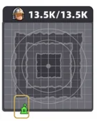
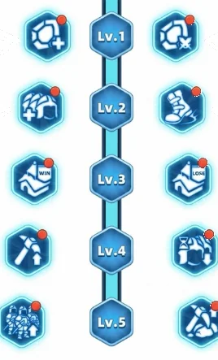
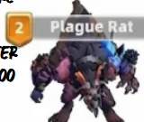
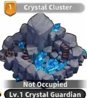
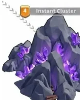
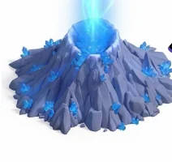
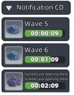

=== guide--en--events--crystal ===
---
layout: guides
title: "Crystal Cluster Valley"
subtitle: "Skills, clusters and how to win the crystals"
active_nav: guides
guide_id: "crystal"
nav_links:
  - name_key: "crystal_valley"
    url: "#valley"
  - name_key: "crystal_skills"
    url: "#skills"
  - name_key: "crystal_clusters"
    url: "#clusters"
  - name_key: "crystal_late"
    url: "#late"
  - name_key: "crystal_controls"
    url: "#controls"
---



<section class="content-pane" id="{{ pane.nav_id }}">
{{ pane.content }}
</section>



=== pane--en--events--crystal--01--valley ===
---
title: "The Valley"
nav_id: "valley"
parent_guide: "crystal"
lang: "en"
order: 1
---

Crystal Cluster Valley is a free-for-all: everyone gathers, steals and fights for crystals on one map.

* **The map is in rings.** Each square ring is one level: the lightest grey is level 1, then 2, then 3, then the centre.
* **The higher the level, the more crystals,** and the more competition for them.
* **The big crystal in the centre** (the Sacred Crystal Cluster) opens for the **last 7 minutes**.
* **Plague Rats** roam the map. Defeating them gives you skill crystals, which unlock your skills.

=== pane--en--events--crystal--02--skills ===
---
title: "Skills"
nav_id: "skills"
parent_guide: "crystal"
lang: "en"
order: 2
---

The skill tree has five levels, with a choice of two skills on each. Unlocking every level takes **2,300 skill crystals**. Pick by how you play: gathering or fighting.

#### Level 1

* **Left:** +1,080 crystals every so often.
* **Right:** +1,500 crystals for each rat you kill.
* **Pick:** right if you'll keep killing rats. Left if you'll stop once all your skills are unlocked.

#### Level 2

* **Left:** +50 march capacity for a single hero.
* **Right:** +25% march speed.
* **Pick:** right, for the speed advantage.

#### Level 3

* **Left:** +5,000 crystals when you **succeed** in seizing a cluster.
* **Right:** +5,000 crystals when you **fail** to seize a cluster.
* **Pick:** when you go to steal an occupied cluster, left if you're likely to win, right if you're likely to lose. It depends on whether you hit hard or take heavy hits.

#### Level 4

* **Left:** +15% gathering speed.
* **Right:** debuffs last 30 seconds less.
* **Pick:** left for gatherers, right for attackers.

#### Level 5

* **Left:** +15% hero damage for 60 seconds (300-second cooldown).
* **Right:** +50% gathering speed for 60 seconds (300-second cooldown).
* **Pick:** left for fighters, right for gatherers.

#### Getting skill crystals

Level up the skill tree by defeating Plague Rats:

* **Level 1 rat** (200K Might): 75 skill crystals.
* **Level 2 rat** (500K Might): 150 skill crystals.

=== pane--en--events--crystal--03--clusters ===
---
title: "Clusters"
nav_id: "clusters"
parent_guide: "crystal"
lang: "en"
order: 3
---

#### Crystal clusters

* A **Crystal Guardian** (level 1, 2 or 3) under a cluster means nobody has occupied it yet. When you reach it, **3 crystals pop out** that your scouts can gather.
* The higher the cluster's level, the more crystals it holds to gather, and the bigger its instant drop: **800 to 3,000 crystals** at once.
* Crystals also pop out around a cluster when it's taken. **Steal them, and be quick!**
* With the level 3 skill for a successful seize, knock someone off a cluster **once a minute** for 5,000 crystals.

#### Instant clusters

* **Go for these when there are no rats to kill.**
* If there are no rats and no Guardian crystals near you, teleport to an area that has them.

#### The Sacred Crystal Cluster

When the centre opens (the last 7 minutes): **teleport there, activate your +15% hero damage skill, and attack!**

=== pane--en--events--crystal--04--late ===
---
title: "Late Method"
nav_id: "late"
parent_guide: "crystal"
lang: "en"
order: 4
---

**Scotty's late method**, for players who fight:

1. **Enter the event 10–15 minutes late.**
2. **Take the fighting skills:** +1,500 crystals per rat kill, +25% march speed, +5,000 crystals for a successful seize, shorter debuffs, and +15% hero damage for 60 seconds.
3. **Kill as many Plague Rats as you can**: each one is worth 1,500 crystals with your level 1 skill.
4. **Knock players off clusters** once a minute for 5,000 crystals each time, and grab the crystals that pop out.
5. **No rats left?** Take the Instant Clusters, or teleport to where the Guardian crystals are.
6. **When the centre opens,** teleport there, activate +15% hero damage and attack.

=== pane--en--events--crystal--05--controls ===
---
title: "Controls"
nav_id: "controls"
parent_guide: "crystal"
lang: "en"
order: 5
---

#### Teleport

You get **1 free teleport every 5 minutes**. The countdown under the button shows when the next one is ready.

#### Notification timers

The timers show when the next Instant Clusters will appear, and when the centre opens.

#### Skill button

The level 5 skill is **not passive**: tap this symbol, then tap **Activate**.
