=== guide--en--events--duel ===
---
layout: guides
title: "Alliance Duel"
subtitle: "What to do on each day of the week"
active_nav: guides
guide_id: "duel"
nav_links:
  - name_key: "duel_overview"
    url: "#overview"
  - name_key: "duel_day1"
    url: "#day1"
  - name_key: "duel_day2"
    url: "#day2"
  - name_key: "duel_day3"
    url: "#day3"
  - name_key: "duel_day4"
    url: "#day4"
  - name_key: "duel_day5"
    url: "#day5"
  - name_key: "duel_day6"
    url: "#day6"
---



<section class="content-pane" id="{{ pane.nav_id }}">
{{ pane.content }}
</section>



=== pane--en--events--duel--01--overview ===
---
title: "Overview"
nav_id: "overview"
parent_guide: "duel"
lang: "en"
order: 1
---

The Alliance Duel runs from **Monday to Saturday**, and each day has its own theme. Only that day's tasks earn points, so save your items and speed-ups for the day that rewards them.

* **Day 1 (Monday):** Raven Enhancement
* **Day 2 (Tuesday):** Territory Enhancement
* **Day 3 (Wednesday):** Tech Research
* **Day 4 (Thursday):** Hero Enhancement
* **Day 5 (Friday):** War Preparations
* **Day 6 (Saturday):** Invasion Day

#### Sunday: get ready

* **Before the reset:** complete your Falcon Quests, but **don't** collect them.
* Send your lineups out to gather, so they bring resources back on Day 1.
* **Save for the week:** speed-ups, recruitment, Covert Ops and Caravan tickets, Raven chests, antitoxins and hero shards.

> #### ⚠️ The Falcon Quest rule
> Falcon Quests count on **Days 1, 3 and 5** only. Complete them the day before, then collect them on the day. Never collect them on Days 2, 4 or 6: that is the single biggest cause of lost points in the Alliance Duel.

=== pane--en--events--duel--02--day1 ===
---
title: "Day 1: Raven"
nav_id: "day1"
parent_guide: "duel"
lang: "en"
order: 2
---

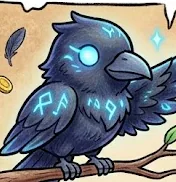

**Monday: Raven Enhancement**

*  **Collect your Falcon Quests** (completed the day before).
*  Consume Raven Fruit and Essence.
*  Consume Stamina.
* Use Antitoxins if needed.
*  Consume Hero XP.
* 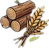 **Gather resources:** send your gatherers out the day before. Wood and grain give the most points.
* 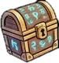 Open Epigraph Chests.

=== pane--en--events--duel--03--day2 ===
---
title: "Day 2: Territory"
nav_id: "day2"
parent_guide: "duel"
lang: "en"
order: 3
---

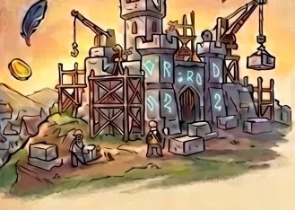

**Tuesday: Territory Enhancement**

* 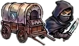 Use UR Caravans and UR Covert Ops.
* 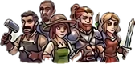 Recruit Survivors.
*  Consume Weapon Shards.
*  Use Construction Speed-Ups.
*  Increase your Build Might.

> #### ⚠️ No Falcon Quests today
> Complete them today, but collect them tomorrow.

=== pane--en--events--duel--04--day3 ===
---
title: "Day 3: Research"
nav_id: "day3"
parent_guide: "duel"
lang: "en"
order: 4
---

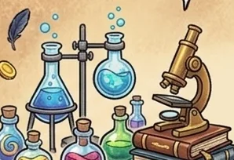

**Wednesday: Tech Research**

* 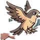 **Collect your Falcon Quests** (completed the day before).
*  Use Study Scrolls.
* 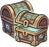 Open Raven Gear Chests.
*  Use Research Speed-Ups.
*  Increase your Tech Might.

=== pane--en--events--duel--05--day4 ===
---
title: "Day 4: Heroes"
nav_id: "day4"
parent_guide: "duel"
lang: "en"
order: 5
---

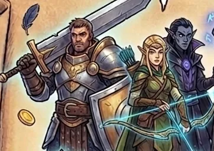

**Thursday: Hero Enhancement**

* 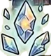 Consume Awakening Shards.
* 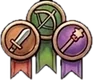 Consume Skill Badges.
*  Consume Hero Shards.
*  Consume Hero XP.
*  Recruit Heroes with your recruitment tickets.

> #### ⚠️ No Falcon Quests today
> Complete them today, but collect them tomorrow.

=== pane--en--events--duel--06--day5 ===
---
title: "Day 5: War Prep"
nav_id: "day5"
parent_guide: "duel"
lang: "en"
order: 6
---

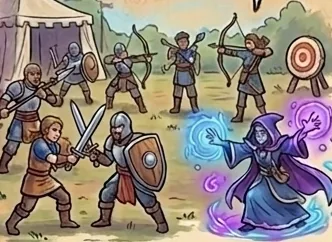

**Friday: War Preparations**

#### High priority

* 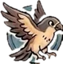 **Collect your Falcon Quests** (completed the day before).
* 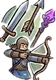 **Train troops:** promote them in a waterfall, 6 → 7 → 8 → 9, matched to your troop levels.
*  Consume Training Speed-Ups.

#### Low priority

* 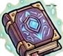 Consume Research Speed-Ups.
* 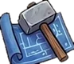 Consume Construction Speed-Ups.

=== pane--en--events--duel--07--day6 ===
---
title: "Day 6: Invasion"
nav_id: "day6"
parent_guide: "duel"
lang: "en"
order: 7
---

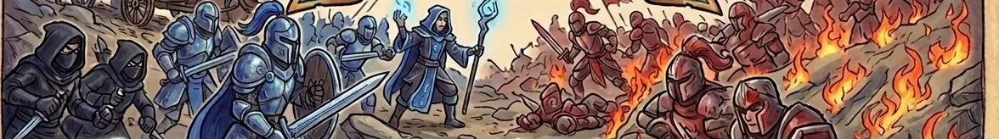

**Saturday: Invasion Day.** Kill everything!

* 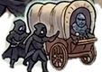 Use UR Caravans and Covert Ops.
* 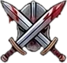 **Kill enemies.** The [Kill Event guide](kill_event.html) shows how to reach your opponent's server and who to hit.
*  Consume Healing Speed-Ups.
*  Consume Training Speed-Ups.
*  Consume Construction Speed-Ups.
*  Consume Research Speed-Ups.

> #### ⚠️ Losing soldiers
> Losing soldiers earns you points too, but don't throw troops away on purpose: your opponent scores more for killing them than you get for losing them, so it's a trade you lose.

=== guide--de--events--duel ===
---
layout: guides
title: "Allianz-Duell"
subtitle: "Was an jedem Tag der Woche zu tun ist"
active_nav: guides
guide_id: "duel"
nav_links:
  - name_key: "duel_overview"
    url: "#overview"
  - name_key: "duel_day1"
    url: "#day1"
  - name_key: "duel_day2"
    url: "#day2"
  - name_key: "duel_day3"
    url: "#day3"
  - name_key: "duel_day4"
    url: "#day4"
  - name_key: "duel_day5"
    url: "#day5"
  - name_key: "duel_day6"
    url: "#day6"
---



<section class="content-pane" id="{{ pane.nav_id }}">
{{ pane.content }}
</section>



=== pane--de--events--duel--01--overview ===
---
title: "Übersicht"
nav_id: "overview"
parent_guide: "duel"
lang: "de"
order: 1
---

Das Allianz-Duell läuft von **Montag bis Samstag**, und jeder Tag hat sein eigenes Thema. Nur die Aufgaben des jeweiligen Tages bringen Punkte. Spare daher deine Gegenstände und Beschleuniger für den Tag auf, an dem sie belohnt werden.

* **Tag 1 (Montag):** Raben-Verbesserung
* **Tag 2 (Dienstag):** Gebiets-Verbesserung
* **Tag 3 (Mittwoch):** Tech-Forschung
* **Tag 4 (Donnerstag):** Helden-Verbesserung
* **Tag 5 (Freitag):** Kriegsvorbereitungen
* **Tag 6 (Samstag):** Invasionstag

#### Sonntag: Vorbereitung

* **Vor dem Reset:** Schließe deine Falken-Quests ab, aber **löse sie nicht ein**.
* Sende deine Truppen zum Sammeln aus, damit sie die Ressourcen an Tag 1 zurückbringen.
* **Für die Woche sparen:** Beschleuniger, Rekrutierungen, Covert-Ops- und Karawanen-Tickets, Rabentruhen, Antitoxine und Heldenseelensteine.

> #### ⚠️ Die Falken-Quest-Regel
> Falken-Quests zählen nur an **Tag 1, 3 und 5**. Schließe sie am Vortag ab und löse sie dann am entsprechenden Tag ein. Löse sie niemals an Tag 2, 4 oder 6 ein: Das ist die häufigste Ursache für verlorene Punkte im Allianz-Duell.

=== pane--de--events--duel--02--day1 ===
---
title: "Tag 1: Rabe"
nav_id: "day1"
parent_guide: "duel"
lang: "de"
order: 2
---

**Montag: Raben-Verbesserung**

*  **Löse deine Falken-Quests ein** (am Vortag abgeschlossen).
*  Verbrauche Rabenfrüchte und Essenz.
*  Verbrauche Ausdauer.
* Verwende bei Bedarf Antitoxine.
*  Verbrauche Helden-EP.
*  **Ressourcen sammeln:** Sende deine Sammler am Vortag aus. Holz und Getreide bringen die meisten Punkte.
*  Öffne Epigraph-Truhen.

=== pane--de--events--duel--03--day2 ===
---
title: "Tag 2: Gebiet"
nav_id: "day2"
parent_guide: "duel"
lang: "de"
order: 3
---

**Dienstag: Gebiets-Verbesserung**

*  Verwende UR-Karawanen und UR-Covert-Ops.
*  Rekrutiere Überlebende.
*  Verbrauche Waffenseelensteine.
*  Verwende Bau-Beschleuniger.
*  Erhöhe deine Bau-Stärke.

> #### ⚠️ Heute keine Falken-Quests einlösen
> Schließe sie heute ab, aber löse sie erst morgen ein.

=== pane--de--events--duel--04--day3 ===
---
title: "Tag 3: Forschung"
nav_id: "day3"
parent_guide: "duel"
lang: "de"
order: 4
---

**Mittwoch: Tech-Forschung**

*  **Löse deine Falken-Quests ein** (am Vortag abgeschlossen).
*  Verwende Studienrollen.
*  Öffne Rabenausrüstungs-Truhen.
*  Verwende Forschungs-Beschleuniger.
*  Erhöhe deine Tech-Stärke.

=== pane--de--events--duel--05--day4 ===
---
title: "Tag 4: Helden"
nav_id: "day4"
parent_guide: "duel"
lang: "de"
order: 5
---

**Donnerstag: Helden-Verbesserung**

*  Verbrauche Erweckungs-Seelensteine.
*  Verbrauche Skill-Abzeichen.
*  Verbrauche Helden-Seelensteine.
*  Verbrauche Helden-EP.
*  Rekrutiere Helden mit deinen Rekrutierungstickets.

> #### ⚠️ Heute keine Falken-Quests einlösen
> Schließe sie heute ab, aber löse sie erst morgen ein.

=== pane--de--events--duel--06--day5 ===
---
title: "Tag 5: Kriegsvorbereitung"
nav_id: "day5"
parent_guide: "duel"
lang: "de"
order: 6
---

**Freitag: Kriegsvorbereitungen**

#### Hohe Priorität

*  **Löse deine Falken-Quests ein** (am Vortag abgeschlossen).
*  **Truppen trainieren:** Befördere sie kaskadierend, 6 → 7 → 8 → 9, passend zu deinen Truppenstufen.
*  Verbrauche Trainings-Beschleuniger.

#### Niedrige Priorität

*  Verbrauche Forschungs-Beschleuniger.
*  Verbrauche Bau-Beschleuniger.

=== pane--de--events--duel--07--day6 ===
---
title: "Tag 6: Invasion"
nav_id: "day6"
parent_guide: "duel"
lang: "de"
order: 7
---

**Samstag: Invasionstag.** Töte alles!

*  Verwende UR-Karawanen und Covert-Ops.
*  **Töte Feinde.** Der [Kill-Event-Guide](kill_event.html) zeigt, wie du den Server deines Gegners erreichst und wen du angreifen solltest.
*  Verbrauche Heilungs-Beschleuniger.
*  Verbrauche Trainings-Beschleuniger.
*  Verbrauche Bau-Beschleuniger.
*  Verbrauche Forschungs-Beschleuniger.

> #### ⚠️ Verlust von Soldaten
> Der Verlust von Soldaten bringt dir ebenfalls Punkte, aber verschwende deine Truppen nicht absichtlich: Dein Gegner erhält mehr Punkte für das Töten deiner Truppen, als du für deren Verlust bekommst – ein Tausch, bei dem du verlierst.

=== guide--es--events--duel ===
---
layout: guides
title: "Duelo de Alianzas"
subtitle: "Qué hacer cada día de la semana"
active_nav: guides
guide_id: "duel"
nav_links:
  - name_key: "duel_overview"
    url: "#overview"
  - name_key: "duel_day1"
    url: "#day1"
  - name_key: "duel_day2"
    url: "#day2"
  - name_key: "duel_day3"
    url: "#day3"
  - name_key: "duel_day4"
    url: "#day4"
  - name_key: "duel_day5"
    url: "#day5"
  - name_key: "duel_day6"
    url: "#day6"
---



<section class="content-pane" id="{{ pane.nav_id }}">
{{ pane.content }}
</section>



=== pane--es--events--duel--01--overview ===
---
title: "Visión general"
nav_id: "overview"
parent_guide: "duel"
lang: "es"
order: 1
---

El Duelo de Alianzas se desarrolla de **lunes a sábado** y cada día tiene su propia temática. Solo las tareas de ese día otorgan puntos, así que guarda tus objetos y aceleradores para el día que los premie.

* **Día 1 (Lunes):** Mejora de Cuervo
* **Día 2 (Martes):** Mejora de Territorio
* **Día 3 (Miércoles):** Investigación Tecnológica
* **Día 4 (Jueves):** Mejora de Héroes
* **Día 5 (Viernes):** Preparativos de Guerra
* **Día 6 (Sábado):** Día de Invasión

#### Domingo: prepárate

* **Antes del reinicio:** completa tus Misiones de Halcón, pero **no las recojas**.
* Envía a tus formaciones a recolectar para que traigan recursos de vuelta el Día 1.
* **Ahorra para la semana:** aceleradores, reclutamiento, boletos de Operaciones Encubiertas y Caravana, cofres de Cuervo, antitoxinas y fragmentos de héroe.

> #### ⚠️ La regla de las Misiones de Halcón
> Las Misiones de Halcón cuentan **solo los días 1, 3 y 5**. Complétalas el día anterior y recógelas en el día correspondiente. Nunca las recojas los días 2, 4 o 6: esa es la mayor causa de pérdida de puntos en el Duelo de Alianzas.

=== pane--es--events--duel--02--day1 ===
---
title: "Día 1: Cuervo"
nav_id: "day1"
parent_guide: "duel"
lang: "es"
order: 2
---

**Lunes: Mejora de Cuervo**

*  **Recoge tus Misiones de Halcón** (completadas el día anterior).
*  Consume Fruta y Esencia de Cuervo.
*  Consume Energía.
* Usa Antitoxinas si es necesario.
*  Consume EXP de Héroe.
*  **Recolecta recursos:** envía a tus recolectores el día anterior. La madera y el grano son los que más puntos dan.
*  Abre cofres de Epígrafe.

=== pane--es--events--duel--03--day2 ===
---
title: "Día 2: Territorio"
nav_id: "day2"
parent_guide: "duel"
lang: "es"
order: 3
---

**Martes: Mejora de Territorio**

*  Usa Caravanas UR y Operaciones Encubiertas UR.
*  Recluta supervivientes.
*  Consume Fragmentos de Arma.
*  Usa aceleradores de construcción.
*  Aumenta tu Poder de Construcción.

> #### ⚠️ No hay Misiones de Halcón hoy
> Complétalas hoy, pero recógelas mañana.

=== pane--es--events--duel--04--day3 ===
---
title: "Día 3: Investigación"
nav_id: "day3"
parent_guide: "duel"
lang: "es"
order: 4
---

**Miércoles: Investigación Tecnológica**

*  **Recoge tus Misiones de Halcón** (completadas el día anterior).
*  Usa Pergaminos de Estudio.
*  Abre cofres de Equipo de Cuervo.
*  Usa aceleradores de investigación.
*  Aumenta tu Poder Tecnológico.

=== pane--es--events--duel--05--day4 ===
---
title: "Día 4: Héroes"
nav_id: "day4"
parent_guide: "duel"
lang: "es"
order: 5
---

**Jueves: Mejora de Héroes**

*  Consume Fragmentos de Despertar.
*  Consume Insignias de Habilidad.
*  Consume Fragmentos de Héroe.
*  Consume EXP de Héroe.
*  Recluta héroes con tus boletos de reclutamiento.

> #### ⚠️ No hay Misiones de Halcón hoy
> Complétalas hoy, pero recógelas mañana.

=== pane--es--events--duel--06--day5 ===
---
title: "Día 5: Preparativos de Guerra"
nav_id: "day5"
parent_guide: "duel"
lang: "es"
order: 6
---

**Viernes: Preparativos de Guerra**

#### Prioridad alta

*  **Recoge tus Misiones de Halcón** (completadas el día anterior).
*  **Entrena tropas:** promuévelas en cascada, 6 → 7 → 8 → 9, según tus niveles de tropa.
*  Consume aceleradores de entrenamiento.

#### Prioridad baja

*  Consume aceleradores de investigación.
*  Consume aceleradores de construcción.

=== pane--es--events--duel--07--day6 ===
---
title: "Día 6: Invasión"
nav_id: "day6"
parent_guide: "duel"
lang: "es"
order: 7
---

**Sábado: Día de Invasión.** ¡Acaba con todo!

*  Usa Caravanas UR y Operaciones Encubiertas.
*  **Mata enemigos.** La [guía del Evento de Matanza](kill_event.html) muestra cómo llegar al servidor de tu oponente y a quién atacar.
*  Consume aceleradores de curación.
*  Consume aceleradores de entrenamiento.
*  Consume aceleradores de construcción.
*  Consume aceleradores de investigación.

> #### ⚠️ Perder soldados
> Perder soldados también te da puntos, pero no sacrifiques tropas a propósito: tu oponente gana más puntos por matarlas que tú por perderlas, así que es un intercambio en el que pierdes.

=== guide--fr--events--duel ===
---
layout: guides
title: "Duel d'Alliances"
subtitle: "Que faire chaque jour de la semaine"
active_nav: guides
guide_id: "duel"
nav_links:
  - name_key: "duel_overview"
    url: "#overview"
  - name_key: "duel_day1"
    url: "#day1"
  - name_key: "duel_day2"
    url: "#day2"
  - name_key: "duel_day3"
    url: "#day3"
  - name_key: "duel_day4"
    url: "#day4"
  - name_key: "duel_day5"
    url: "#day5"
  - name_key: "duel_day6"
    url: "#day6"
---



<section class="content-pane" id="{{ pane.nav_id }}">
{{ pane.content }}
</section>



=== pane--fr--events--duel--01--overview ===
---
title: "Vue d'ensemble"
nav_id: "overview"
parent_guide: "duel"
lang: "fr"
order: 1
---

Le Duel d'Alliances se déroule du **lundi au samedi**, chaque jour ayant son propre thème. Seules les tâches du jour permettent de gagner des points ; gardez donc vos objets et vos accélérations pour le jour qui les récompense.

* **Jour 1 (Lundi) :** Amélioration du Corbeau
* **Jour 2 (Mardi) :** Amélioration du Territoire
* **Jour 3 (Mercredi) :** Recherche technologique
* **Jour 4 (Jeudi) :** Amélioration des Héros
* **Jour 5 (Vendredi) :** Préparatifs de Guerre
* **Jour 6 (Samedi) :** Journée d'Invasion

#### Dimanche : préparez-vous

* **Avant la réinitialisation :** accomplissez vos Quêtes de Faucon, mais **ne les validez pas**.
* Envoyez vos lignes de troupes collecter des ressources pour qu'elles rentrent le Jour 1.
* **Économisez pour la semaine :** accélérations, recrutement, billets d'Opérations Secrètes et de Caravanes, coffres du Corbeau, antitoxines et fragments de héros.

> #### ⚠️ La règle des Quêtes de Faucon
> Les Quêtes de Faucon comptent uniquement les **Jours 1, 3 et 5**. Accomplissez-les la veille, puis validez-les le jour même. Ne les validez jamais les Jours 2, 4 ou 6 : c'est la cause numéro un de perte de points dans le Duel d'Alliances.

=== pane--fr--events--duel--02--day1 ===
---
title: "Jour 1 : Corbeau"
nav_id: "day1"
parent_guide: "duel"
lang: "fr"
order: 2
---

**Lundi : Amélioration du Corbeau**

*  **Validez vos Quêtes de Faucon** (accomplies la veille).
*  Consommez du Fruit et de l'Essence de Corbeau.
*  Consommez de l'Endurance.
* Utilisez des Antitoxines si nécessaire.
*  Consommez de l'XP de Héros.
*  **Collectez des ressources :** envoyez vos collecteurs la veille. Le bois et le grain rapportent le plus de points.
*  Ouvrez les Coffres d'Épigraphe.

=== pane--fr--events--duel--03--day2 ===
---
title: "Jour 2 : Territoire"
nav_id: "day2"
parent_guide: "duel"
lang: "fr"
order: 3
---

**Mardi : Amélioration du Territoire**

*  Utilisez les Caravanes UR et les Opérations Secrètes UR.
*  Recrutez des Survivants.
*  Consommez des Fragments d'Arme.
*  Utilisez des accélérations de Construction.
*  Augmentez votre Puissance de Bâtiment.

> #### ⚠️ Pas de Quêtes de Faucon aujourd'hui
> Accomplissez-les aujourd'hui, mais validez-les demain.

=== pane--fr--events--duel--04--day3 ===
---
title: "Jour 3 : Recherche"
nav_id: "day3"
parent_guide: "duel"
lang: "fr"
order: 4
---

**Mercredi : Recherche technologique**

*  **Validez vos Quêtes de Faucon** (accomplies la veille).
*  Utilisez des Parchemins d'Étude.
*  Ouvrez les Coffres d'Équipement du Corbeau.
*  Utilisez des accélérations de Recherche.
*  Augmentez votre Puissance technologique.

=== pane--fr--events--duel--05--day4 ===
---
title: "Jour 4 : Héros"
nav_id: "day4"
parent_guide: "duel"
lang: "fr"
order: 5
---

**Jeudi : Amélioration des Héros**

*  Consommez des Fragments d'Éveil.
*  Consommez des Badges de Compétence.
*  Consommez des Fragments de Héros.
*  Consommez de l'XP de Héros.
*  Recrutez des Héros avec vos tickets de recrutement.

> #### ⚠️ Pas de Quêtes de Faucon aujourd'hui
> Accomplissez-les aujourd'hui, mais validez-les demain.

=== pane--fr--events--duel--06--day5 ===
---
title: "Jour 5 : Prépa Guerre"
nav_id: "day5"
parent_guide: "duel"
lang: "fr"
order: 6
---

**Vendredi : Préparatifs de Guerre**

#### Priorité haute

*  **Validez vos Quêtes de Faucon** (accomplies la veille).
*  **Entraînez des troupes :** promouvez-les en cascade, 6 → 7 → 8 → 9, en fonction de vos niveaux de troupes.
*  Consommez des accélérations d'Entraînement.

#### Priorité basse

*  Consommez des accélérations de Recherche.
*  Consommez des accélérations de Construction.

=== pane--fr--events--duel--07--day6 ===
---
title: "Jour 6 : Invasion"
nav_id: "day6"
parent_guide: "duel"
lang: "fr"
order: 7
---

**Samedi : Journée d'Invasion.** Tuez tout !

*  Utilisez les Caravanes UR et les Opérations Secrètes.
*  **Tuez des ennemis.** Le [Guide de l'événement de mort](kill_event.html) montre comment atteindre le serveur de votre adversaire et qui attaquer.
*  Consommez des accélérations de Soin.
*  Consommez des accélérations d'Entraînement.
*  Consommez des accélérations de Construction.
*  Consommez des accélérations de Recherche.

> #### ⚠️ Perte de soldats
> Perdre des soldats vous rapporte également des points, mais ne sacrifiez pas vos troupes volontairement : votre adversaire marque plus de points en les tuant que vous n'en gagnez en les perdant ; c'est donc un échange perdant.

=== guide--ru--events--duel ===
---
layout: guides
title: "Дуэль Альянсов"
subtitle: "Что делать в каждый день недели"
active_nav: guides
guide_id: "duel"
nav_links:
  - name_key: "duel_overview"
    url: "#overview"
  - name_key: "duel_day1"
    url: "#day1"
  - name_key: "duel_day2"
    url: "#day2"
  - name_key: "duel_day3"
    url: "#day3"
  - name_key: "duel_day4"
    url: "#day4"
  - name_key: "duel_day5"
    url: "#day5"
  - name_key: "duel_day6"
    url: "#day6"
---



<section class="content-pane" id="{{ pane.nav_id }}">
{{ pane.content }}
</section>



=== pane--ru--events--duel--01--overview ===
---
title: "Обзор"
nav_id: "overview"
parent_guide: "duel"
lang: "ru"
order: 1
---

Дуэль Альянсов проходит с **понедельника по субботу**, и у каждого дня есть своя тема. Очки начисляются только за задания конкретного дня, поэтому приберегите свои предметы и ускорения для того дня, в который они приносят награды.

* **День 1 (Понедельник):** Усиление Воронов
* **День 2 (Вторник):** Развитие территории
* **День 3 (Среда):** Исследования технологий
* **День 4 (Четверг):** Усиление героев
* **День 5 (Пятница):** Подготовка к войне
* **День 6 (Суббота):** День вторжения

#### Воскресенье: подготовка

* **Перед сбросом:** выполните задания Сокола, но **не забирайте** награды.
* Отправьте свои отряды на сбор ресурсов, чтобы они вернулись в 1-й день.
* **Копите на неделю:** ускорения, найм, билеты тайных операций и караванов, сундуки Воронов, антитоксины и осколки героев.

> #### ⚠️ Правило заданий Сокола
> Задания Сокола засчитываются **только в дни 1, 3 и 5**. Выполняйте их накануне, а затем забирайте награды в нужный день. Никогда не забирайте их в дни 2, 4 или 6: это самая распространенная причина потери очков в Дуэли Альянсов.

=== pane--ru--events--duel--02--day1 ===
---
title: "День 1: Вороны"
nav_id: "day1"
parent_guide: "duel"
lang: "ru"
order: 2
---

**Понедельник: Усиление Воронов**

*  **Заберите награды за задания Сокола** (выполненные накануне).
*  Тратьте Плоды и Эссенцию Воронов.
*  Тратьте энергию.
* Используйте антитоксины, если необходимо.
*  Тратьте опыт героев.
*  **Сбор ресурсов:** отправляйте собирателей накануне. Дерево и зерно дают больше всего очков.
*  Открывайте сундуки эпиграфов.

=== pane--ru--events--duel--03--day2 ===
---
title: "День 2: Территория"
nav_id: "day2"
parent_guide: "duel"
lang: "ru"
order: 3
---

**Вторник: Развитие территории**

*  Используйте UR-караваны и UR-тайные операции.
*  Нанимайте выживших.
*  Тратьте осколки оружия.
*  Используйте ускорения строительства.
*  Увеличивайте мощь зданий.

> #### ⚠️ Сегодня заданий Сокола нет
> Выполняйте их сегодня, но забирайте завтра.

=== pane--ru--events--duel--04--day3 ===
---
title: "День 3: Исследования"
nav_id: "day3"
parent_guide: "duel"
lang: "ru"
order: 4
---

**Среда: Исследования технологий**

*  **Заберите награды за задания Сокола** (выполненные накануне).
*  Используйте свитки изучения.
*  Открывайте сундуки снаряжения Воронов.
*  Используйте ускорения исследований.
*  Увеличивайте мощь технологий.

=== pane--ru--events--duel--05--day4 ===
---
title: "День 4: Герои"
nav_id: "day4"
parent_guide: "duel"
lang: "ru"
order: 5
---

**Четверг: Усиление героев**

*  Тратьте осколки пробуждения.
*  Тратьте значки навыков.
*  Тратьте осколки героев.
*  Тратьте опыт героев.
*  Нанимайте героев с помощью билетов найма.

> #### ⚠️ Сегодня заданий Сокола нет
> Выполняйте их сегодня, но забирайте завтра.

=== pane--ru--events--duel--06--day5 ===
---
title: "День 5: Подготовка к войне"
nav_id: "day5"
parent_guide: "duel"
lang: "ru"
order: 6
---

**Пятница: Подготовка к войне**

#### Высокий приоритет

*  **Заберите награды за задания Сокола** (выполненные накануне).
*  **Тренируйте войска:** улучшайте их каскадом, 6 → 7 → 8 → 9, в соответствии с вашими уровнями войск.
*  Тратьте ускорения тренировки.

#### Низкий приоритет

*  Тратьте ускорения исследований.
*  Тратьте ускорения строительства.

=== pane--ru--events--duel--07--day6 ===
---
title: "День 6: Вторжение"
nav_id: "day6"
parent_guide: "duel"
lang: "ru"
order: 7
---

**Суббота: День вторжения.** Убейте всех!

*  Используйте UR-караваны и тайные операции.
*  **Убивайте врагов.** В [гайде по Событию Убийств](kill_event.html) показано, как попасть на сервер противника и кого атаковать.
*  Тратьте ускорения лечения.
*  Тратьте ускорения тренировки.
*  Тратьте ускорения строительства.
*  Тратьте ускорения исследований.

> #### ⚠️ Потеря солдат
> Потеря солдат также приносит очки, но не тратьте войска намеренно: ваш противник получит больше очков за их убийство, чем вы за их потерю, так что это невыгодная сделка.

=== guide--tr--events--duel ===
---
layout: guides
title: "İttifak Düellosu"
subtitle: "Haftanın her gününde yapılması gerekenler"
active_nav: guides
guide_id: "duel"
nav_links:
  - name_key: "duel_overview"
    url: "#overview"
  - name_key: "duel_day1"
    url: "#day1"
  - name_key: "duel_day2"
    url: "#day2"
  - name_key: "duel_day3"
    url: "#day3"
  - name_key: "duel_day4"
    url: "#day4"
  - name_key: "duel_day5"
    url: "#day5"
  - name_key: "duel_day6"
    url: "#day6"
---



<section class="content-pane" id="{{ pane.nav_id }}">
{{ pane.content }}
</section>



=== pane--tr--events--duel--01--overview ===
---
title: "Genel Bakış"
nav_id: "overview"
parent_guide: "duel"
lang: "tr"
order: 1
---

İttifak Düellosu **Pazartesi'den Cumartesi'ye** kadar sürer ve her günün kendine has bir teması vardır. Sadece o günün görevleri puan kazandırır, bu yüzden eşyalarınızı ve hızlandırmalarınızı onları ödüllendiren güne saklayın.

* **1. Gün (Pazartesi):** Kuzgun Geliştirme
* **2. Gün (Salı):** Bölge Geliştirme
* **3. Gün (Çarşamba):** Teknoloji Araştırması
* **4. Gün (Perşembe):** Kahraman Geliştirme
* **5. Gün (Cuma):** Savaş Hazırlıkları
* **6. Gün (Cumartesi):** İstilâ Günü

#### Pazar: Hazırlık

* **Sıfırlamadan önce:** Şahin Görevlerinizi tamamlayın ancak **toplamayın**.
* Birliklerinizi toplamaya gönderin, böylece 1. Gün kaynakları geri getirirler.
* **Hafta için biriktirin:** hızlandırmalar, asker alımı, Gizli Operasyon ve Kervan biletleri, Kuzgun sandıkları, antitoksinler ve kahraman parçaları.

> #### ⚠️ Şahin Görevi kuralı
> Şahin Görevleri sadece **1, 3 ve 5. Günlerde** puan kazandırır. Bunları bir önceki gün tamamlayın, ardından ilgili günde toplayın. Bunları asla 2, 4 veya 6. Günlerde toplamayın: bu, İttifak Düellosu'nda en büyük puan kaybı nedenidir.

=== pane--tr--events--duel--02--day1 ===
---
title: "1. Gün: Kuzgun"
nav_id: "day1"
parent_guide: "duel"
lang: "tr"
order: 2
---

**Pazartesi: Kuzgun Geliştirme**

*  **Şahin Görevlerinizi toplayın** (bir önceki gün tamamladıklarınız).
*  Kuzgun Meyvesi ve Özü tüketin.
*  Dayanıklılık harcayın.
* Gerekirse Antitoksin kullanın.
*  Kahraman TP tüketin.
*  **Kaynak toplayın:** toplayıcılarınızı bir önceki günden gönderin. Odun ve tahıl en çok puanı verir.
*  Epigraf Sandıkları açın.

=== pane--tr--events--duel--03--day2 ===
---
title: "2. Gün: Bölge"
nav_id: "day2"
parent_guide: "duel"
lang: "tr"
order: 3
---

**Salı: Bölge Geliştirme**

*  UR Kervanları ve UR Gizli Operasyonları kullanın.
*  Kurtulanları askere alın.
*  Silah Parçaları tüketin.
*  İnşaat Hızlandırmaları kullanın.
*  Bina Gücünüzü artırın.

> #### ⚠️ Bugün Şahin Görevi yok
> Bunları bugün tamamlayın, ancak yarın toplayın.

=== pane--tr--events--duel--04--day3 ===
---
title: "3. Gün: Araştırma"
nav_id: "day3"
parent_guide: "duel"
lang: "tr"
order: 4
---

**Çarşamba: Teknoloji Araştırması**

*  **Şahin Görevlerinizi toplayın** (bir önceki gün tamamladıklarınız).
*  Çalışma Parşömenleri kullanın.
*  Kuzgun Ekipman Sandıkları açın.
*  Araştırma Hızlandırmaları kullanın.
*  Teknoloji Gücünüzü artırın.

=== pane--tr--events--duel--05--day4 ===
---
title: "4. Gün: Kahramanlar"
nav_id: "day4"
parent_guide: "duel"
lang: "tr"
order: 5
---

**Perşembe: Kahraman Geliştirme**

*  Uyanış Parçaları tüketin.
*  Beceri Rozetleri tüketin.
*  Kahraman Parçaları tüketin.
*  Kahraman TP tüketin.
*  Asker alım biletlerinizle Kahramanlar alın.

> #### ⚠️ Bugün Şahin Görevi yok
> Bunları bugün tamamlayın, ancak yarın toplayın.

=== pane--tr--events--duel--06--day5 ===
---
title: "5. Gün: Savaş Hazırlığı"
nav_id: "day5"
parent_guide: "duel"
lang: "tr"
order: 6
---

**Cuma: Savaş Hazırlıkları**

#### Yüksek öncelik

*  **Şahin Görevlerinizi toplayın** (bir önceki gün tamamladıklarınız).
*  **Asker eğitin:** asker seviyelerinize uygun şekilde 6 → 7 → 8 → 9 basamaklı bir şekilde terfi ettirin.
*  Eğitim Hızlandırmaları tüketin.

#### Düşük öncelik

*  Araştırma Hızlandırmaları tüketin.
*  İnşaat Hızlandırmaları tüketin.

=== pane--tr--events--duel--07--day6 ===
---
title: "6. Gün: İstilâ"
nav_id: "day6"
parent_guide: "duel"
lang: "tr"
order: 7
---

**Cumartesi: İstilâ Günü.** Her şeyi yok et!

*  UR Kervanları ve Gizli Operasyonlar kullanın.
*  **Düşmanları öldürün.** [Öldürme Etkinliği rehberi](kill_event.html), rakibinizin sunucusuna nasıl ulaşacağınızı ve kime vuracağınızı gösterir.
*  İyileştirme Hızlandırmaları tüketin.
*  Eğitim Hızlandırmaları tüketin.
*  İnşaat Hızlandırmaları tüketin.
*  Araştırma Hızlandırmaları tüketin.

> #### ⚠️ Asker kaybetmek
> Asker kaybetmek de size puan kazandırır, ancak birliklerinizi kasten harcamayın: rakibiniz onları öldürdüğü için siz kaybettiklerinizden daha fazla puan alır, yani bu kaybettiğiniz bir takas olur.

=== guide--uk--events--duel ===
---
layout: guides
title: "Дуель Альянсів"
subtitle: "Що робити кожного дня тижня"
active_nav: guides
guide_id: "duel"
nav_links:
  - name_key: "duel_overview"
    url: "#overview"
  - name_key: "duel_day1"
    url: "#day1"
  - name_key: "duel_day2"
    url: "#day2"
  - name_key: "duel_day3"
    url: "#day3"
  - name_key: "duel_day4"
    url: "#day4"
  - name_key: "duel_day5"
    url: "#day5"
  - name_key: "duel_day6"
    url: "#day6"
---



<section class="content-pane" id="{{ pane.nav_id }}">
{{ pane.content }}
</section>



=== pane--uk--events--duel--01--overview ===
---
title: "Огляд"
nav_id: "overview"
parent_guide: "duel"
lang: "uk"
order: 1
---

Дуель Альянсів триває з **понеділка по суботу**, і кожен день має свою тему. Бали нараховуються лише за завдання поточного дня, тому зберігайте предмети та прискорювачі для дня, коли вони приносять винагороду.

* **День 1 (понеділок):** Посилення Ворона
* **День 2 (вівторок):** Посилення території
* **День 3 (середа):** Дослідження технологій
* **День 4 (четвер):** Посилення героїв
* **День 5 (п'ятниця):** Підготовка до війни
* **День 6 (субота):** День вторгнення

#### Неділя: підготовка

* **Перед скиданням:** виконайте квести Сокола, але **не забирайте** їх.
* Відправте загони на збір ресурсів, щоб вони повернулися в День 1.
* **Зберігайте на тиждень:** прискорювачі, набори найму, квитки на таємні операції та каравани, скрині Ворона, антидоти та уламки героїв.

> #### ⚠️ Правило квестів Сокола
> Квести Сокола враховуються лише в **Дні 1, 3 та 5**. Виконуйте їх за день до цього, а забирайте винагороду в потрібний день. Ніколи не забирайте їх у Дні 2, 4 або 6: це головна причина втрати балів у Дуелі Альянсів.

=== pane--uk--events--duel--02--day1 ===
---
title: "День 1: Ворон"
nav_id: "day1"
parent_guide: "duel"
lang: "uk"
order: 2
---

**Понеділок: Посилення Ворона**

*  **Заберіть нагороди за квести Сокола** (виконані попереднього дня).
*  Використовуйте фрукти та есенцію Ворона.
*  Витрачайте витривалість.
* За потреби використовуйте антидоти.
*  Витрачайте досвід героїв.
*  **Збір ресурсів:** відправте збирачів за день до цього. Деревина та зерно дають найбільше балів.
*  Відкривайте скрині з епіграфами.

=== pane--uk--events--duel--03--day2 ===
---
title: "День 2: Територія"
nav_id: "day2"
parent_guide: "duel"
lang: "uk"
order: 3
---

**Вівторок: Посилення території**

*  Використовуйте UR-каравани та UR-таємні операції.
*  Наймайте вцілілих.
*  Витрачайте уламки зброї.
*  Використовуйте прискорювачі будівництва.
*  Збільшуйте міць будівництва.

> #### ⚠️ У ці дні немає квестів Сокола
> Виконуйте їх сьогодні, але забирайте нагороди завтра.

=== pane--uk--events--duel--04--day3 ===
---
title: "День 3: Дослідження"
nav_id: "day3"
parent_guide: "duel"
lang: "uk"
order: 4
---

**Середа: Дослідження технологій**

*  **Заберіть нагороди за квести Сокола** (виконані попереднього дня).
*  Використовуйте сувої навчання.
*  Відкривайте скрині спорядження Ворона.
*  Використовуйте прискорювачі досліджень.
*  Збільшуйте міць технологій.

=== pane--uk--events--duel--05--day4 ===
---
title: "День 4: Герої"
nav_id: "day4"
parent_guide: "duel"
lang: "uk"
order: 5
---

**Четвер: Посилення героїв**

*  Витрачайте уламки пробудження.
*  Витрачайте значки навичок.
*  Витрачайте уламки героїв.
*  Витрачайте досвід героїв.
*  Наймайте героїв за допомогою квитків найму.

> #### ⚠️ У ці дні немає квестів Сокола
> Виконуйте їх сьогодні, але забирайте нагороди завтра.

=== pane--uk--events--duel--06--day5 ===
---
title: "День 5: Підготовка до війни"
nav_id: "day5"
parent_guide: "duel"
lang: "uk"
order: 6
---

**П'ятниця: Підготовка до війни**

#### Високий пріоритет

*  **Заберіть нагороди за квести Сокола** (виконані попереднього дня).
*  **Тренуйте війська:** просувайте їх ланцюжком, 6 → 7 → 8 → 9, відповідно до рівнів ваших військ.
*  Використовуйте прискорювачі тренувань.

#### Низький пріоритет

*  Використовуйте прискорювачі досліджень.
*  Використовуйте прискорювачі будівництва.

=== pane--uk--events--duel--07--day6 ===
---
title: "День 6: Вторгнення"
nav_id: "day6"
parent_guide: "duel"
lang: "uk"
order: 7
---

**Субота: День вторгнення.** Знищуйте всіх!

*  Використовуйте UR-каравани та таємні операції.
*  **Знищуйте ворогів.** [Гайд щодо події знищення](kill_event.html) показує, як дістатися до сервера противника і кого атакувати.
*  Використовуйте прискорювачі лікування.
*  Використовуйте прискорювачі тренувань.
*  Використовуйте прискорювачі будівництва.
*  Використовуйте прискорювачі досліджень.

> #### ⚠️ Втрата солдатів
> Втрата солдатів також приносить бали, але не жертвуйте військами навмисно: противник отримує більше балів за їх знищення, ніж ви за саму втрату, тому це невигідний обмін.

=== guide--it--events--duel ===
---
layout: guides
title: "Duello tra Alleanze"
subtitle: "Cosa fare ogni giorno della settimana"
active_nav: guides
guide_id: "duel"
nav_links:
  - name_key: "duel_overview"
    url: "#overview"
  - name_key: "duel_day1"
    url: "#day1"
  - name_key: "duel_day2"
    url: "#day2"
  - name_key: "duel_day3"
    url: "#day3"
  - name_key: "duel_day4"
    url: "#day4"
  - name_key: "duel_day5"
    url: "#day5"
  - name_key: "duel_day6"
    url: "#day6"
---



<section class="content-pane" id="{{ pane.nav_id }}">
{{ pane.content }}
</section>



=== pane--it--events--duel--01--overview ===
---
title: "Panoramica"
nav_id: "overview"
parent_guide: "duel"
lang: "it"
order: 1
---

Il Duello tra Alleanze si svolge dal **lunedì al sabato** e ogni giorno ha il suo tema. Solo le attività del giorno assegnato fanno guadagnare punti, quindi conserva i tuoi oggetti e le accelerazioni per il giorno in cui vengono premiati.

* **Giorno 1 (lunedì):** Potenziamento Corvo
* **Giorno 2 (martedì):** Potenziamento Territorio
* **Giorno 3 (mercoledì):** Ricerca tecnologica
* **Giorno 4 (giovedì):** Potenziamento Eroi
* **Giorno 5 (venerdì):** Preparativi di guerra
* **Giorno 6 (sabato):** Giorno dell'Invasione

#### Domenica: preparati

* **Prima del reset:** completa le tue Missioni Falco, ma **non** riscuoterle.
* Invia le tue formazioni a raccogliere risorse, in modo che rientrino il Giorno 1.
* **Risparmia per la settimana:** accelerazioni, reclutamento, biglietti per Operazioni Segrete e Carovane, forzieri Corvo, antitossine e frammenti di eroe.

> #### ⚠️ La regola della Missione Falco
> Le Missioni Falco contano solo nei **Giorni 1, 3 e 5**. Completale il giorno precedente, poi riscuotile nel giorno corretto. Non riscuoterle mai nei Giorni 2, 4 o 6: è la causa principale di perdita di punti nel Duello tra Alleanze.

=== pane--it--events--duel--02--day1 ===
---
title: "Giorno 1: Corvo"
nav_id: "day1"
parent_guide: "duel"
lang: "it"
order: 2
---

**Lunedì: Potenziamento Corvo**

*  **Riscuoti le tue Missioni Falco** (completate il giorno precedente).
*  Consuma Frutti ed Essenza del Corvo.
*  Consuma Vigore.
* Usa le antitossine se necessario.
*  Consuma XP Eroe.
*  **Raccogli risorse:** invia i tuoi raccoglitori il giorno prima. Legno e grano danno più punti.
*  Apri i Forzieri Epigrafici.

=== pane--it--events--duel--03--day2 ===
---
title: "Giorno 2: Territorio"
nav_id: "day2"
parent_guide: "duel"
lang: "it"
order: 3
---

**Martedì: Potenziamento Territorio**

*  Usa Carovane UR e Operazioni Segrete UR.
*  Recluta Sopravvissuti.
*  Consuma Frammenti di Arma.
*  Usa accelerazioni di costruzione.
*  Aumenta la tua Potenza di Edificio.

> #### ⚠️ Nessuna Missione Falco oggi
> Completale oggi, ma riscuotile domani.

=== pane--it--events--duel--04--day3 ===
---
title: "Giorno 3: Ricerca"
nav_id: "day3"
parent_guide: "duel"
lang: "it"
order: 4
---

**Mercoledì: Ricerca tecnologica**

*  **Riscuoti le tue Missioni Falco** (completate il giorno precedente).
*  Usa Pergamene di Studio.
*  Apri i Forzieri Equipaggiamento Corvo.
*  Usa accelerazioni di ricerca.
*  Aumenta la tua Potenza Tech.

=== pane--it--events--duel--05--day4 ===
---
title: "Giorno 4: Eroi"
nav_id: "day4"
parent_guide: "duel"
lang: "it"
order: 5
---

**Giovedì: Potenziamento Eroi**

*  Consuma Frammenti di Risveglio.
*  Consuma Distintivi Abilità.
*  Consuma Frammenti di Eroe.
*  Consuma XP Eroe.
*  Recluta Eroi con i tuoi biglietti di reclutamento.

> #### ⚠️ Nessuna Missione Falco oggi
> Completale oggi, ma riscuotile domani.

=== pane--it--events--duel--06--day5 ===
---
title: "Giorno 5: Prep. Guerra"
nav_id: "day5"
parent_guide: "duel"
lang: "it"
order: 6
---

**Venerdì: Preparativi di guerra**

#### Alta priorità

*  **Riscuoti le tue Missioni Falco** (completate il giorno precedente).
*  **Addestra truppe:** promuovile a cascata, 6 → 7 → 8 → 9, in base ai livelli delle tue truppe.
*  Consuma accelerazioni di addestramento.

#### Bassa priorità

*  Consuma accelerazioni di ricerca.
*  Consuma accelerazioni di costruzione.

=== pane--it--events--duel--07--day6 ===
---
title: "Giorno 6: Invasione"
nav_id: "day6"
parent_guide: "duel"
lang: "it"
order: 7
---

**Sabato: Giorno dell'Invasione.** Uccidi tutti!

*  Usa Carovane UR e Operazioni Segrete.
*  **Uccidi i nemici.** La [guida all'Evento di Uccisione](kill_event.html) mostra come raggiungere il server del tuo avversario e chi attaccare.
*  Consuma accelerazioni di guarigione.
*  Consuma accelerazioni di addestramento.
*  Consuma accelerazioni di costruzione.
*  Consuma accelerazioni di ricerca.

> #### ⚠️ Perdere soldati
> Anche perdere soldati ti fa guadagnare punti, ma non sacrificare truppe di proposito: il tuo avversario ottiene più punti uccidendole di quanti ne ottieni tu perdendole, quindi è uno scambio in cui perdi.
