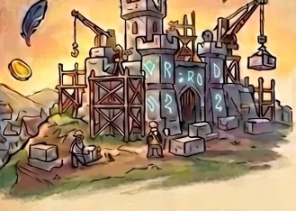
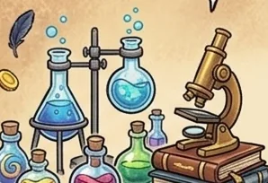
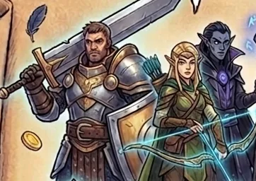
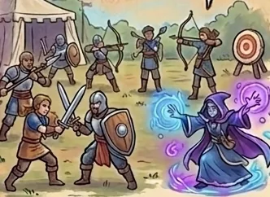
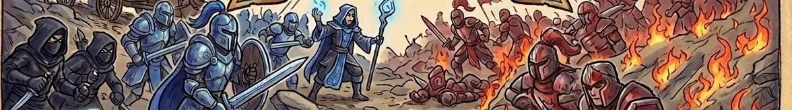

=== guide--en--events--duel ===
---
layout: guides
title: "Alliance Duel"
subtitle: "What to do on each day of the week"
active_nav: guides
guide_id: "duel"
nav_links:
  - name_key: "duel_overview"
    url: "#overview"
  - name_key: "duel_day1"
    url: "#day1"
  - name_key: "duel_day2"
    url: "#day2"
  - name_key: "duel_day3"
    url: "#day3"
  - name_key: "duel_day4"
    url: "#day4"
  - name_key: "duel_day5"
    url: "#day5"
  - name_key: "duel_day6"
    url: "#day6"
---



<section class="content-pane" id="{{ pane.nav_id }}">
{{ pane.content }}
</section>



=== pane--en--events--duel--01--overview ===
---
title: "Overview"
nav_id: "overview"
parent_guide: "duel"
lang: "en"
order: 1
---

The Alliance Duel runs from **Monday to Saturday**, and each day has its own theme. Only that day's tasks earn points, so save your items and speed-ups for the day that rewards them.

* **Day 1 (Monday):** Raven Enhancement
* **Day 2 (Tuesday):** Territory Enhancement
* **Day 3 (Wednesday):** Tech Research
* **Day 4 (Thursday):** Hero Enhancement
* **Day 5 (Friday):** War Preparations
* **Day 6 (Saturday):** Invasion Day

#### Sunday: get ready

* **Before the reset:** complete your Falcon Quests, but **don't** collect them.
* Send your lineups out to gather, so they bring resources back on Day 1.
* **Save for the week:** speed-ups, recruitment, Covert Ops and Caravan tickets, Raven chests, antitoxins and hero shards.

> #### ⚠️ The Falcon Quest rule
> Falcon Quests count on **Days 1, 3 and 5** only. Complete them the day before, then collect them on the day. Never collect them on Days 2, 4 or 6: that is the single biggest cause of lost points in the Alliance Duel.

=== pane--en--events--duel--02--day1 ===
---
title: "Day 1: Raven"
nav_id: "day1"
parent_guide: "duel"
lang: "en"
order: 2
---

**Monday: Raven Enhancement**

* **Collect your Falcon Quests** (completed the day before).
* Consume Raven Fruit and Essence.
* Consume Stamina.
* Use Antitoxins if needed.
* Consume Hero XP.
* **Gather resources:** send your gatherers out the day before. Wood and grain give the most points.
* Open Epigraph Chests.

=== pane--en--events--duel--03--day2 ===
---
title: "Day 2: Territory"
nav_id: "day2"
parent_guide: "duel"
lang: "en"
order: 3
---

**Tuesday: Territory Enhancement**

* Use UR Caravans and UR Covert Ops.
* Recruit Survivors.
* Consume Weapon Shards.
* Use Construction Speed-Ups.
* Increase your Build Might.

> #### ⚠️ No Falcon Quests today
> Complete them today, but collect them tomorrow.

=== pane--en--events--duel--04--day3 ===
---
title: "Day 3: Research"
nav_id: "day3"
parent_guide: "duel"
lang: "en"
order: 4
---

**Wednesday: Tech Research**

* **Collect your Falcon Quests** (completed the day before).
* Use Study Scrolls.
* Open Raven Gear Chests.
* Use Research Speed-Ups.
* Increase your Tech Might.

=== pane--en--events--duel--05--day4 ===
---
title: "Day 4: Heroes"
nav_id: "day4"
parent_guide: "duel"
lang: "en"
order: 5
---

**Thursday: Hero Enhancement**

* Consume Awakening Shards.
* Consume Skill Badges.
* Consume Hero Shards.
* Consume Hero XP.
* Recruit Heroes with your recruitment tickets.

> #### ⚠️ No Falcon Quests today
> Complete them today, but collect them tomorrow.

=== pane--en--events--duel--06--day5 ===
---
title: "Day 5: War Prep"
nav_id: "day5"
parent_guide: "duel"
lang: "en"
order: 6
---

**Friday: War Preparations**

#### High priority

* **Collect your Falcon Quests** (completed the day before).
* **Train troops:** promote them in a waterfall, 6 → 7 → 8 → 9, matched to your troop levels.
* Consume Training Speed-Ups.

#### Low priority

* Consume Research Speed-Ups.
* Consume Construction Speed-Ups.

=== pane--en--events--duel--07--day6 ===
---
title: "Day 6: Invasion"
nav_id: "day6"
parent_guide: "duel"
lang: "en"
order: 7
---

**Saturday: Invasion Day.** Kill everything!

* Use UR Caravans and Covert Ops.
* **Kill enemies.** The [Kill Event guide](kill_event.html) shows how to reach your opponent's server and who to hit.
* Consume Healing Speed-Ups.
* Consume Training Speed-Ups.
* Consume Construction Speed-Ups.
* Consume Research Speed-Ups.

> #### ⚠️ Losing soldiers
> Losing soldiers earns you points too, but don't throw troops away on purpose: your opponent scores more for killing them than you get for losing them, so it's a trade you lose.
