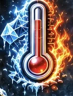
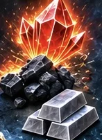
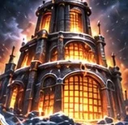
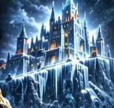
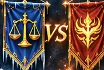
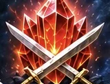
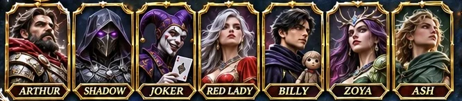

=== guide--en--strategy--frozen_era ===
---
layout: guides
title: "Frozen Era"
subtitle: "Season 2 survival guide"
active_nav: guides
guide_id: "frozen_era"
nav_links:
  - name_key: "frozen_era_temperature"
    url: "#temperature"
  - name_key: "frozen_era_resources"
    url: "#resources"
  - name_key: "frozen_era_buildings"
    url: "#buildings"
  - name_key: "frozen_era_realm"
    url: "#realm"
  - name_key: "frozen_era_factions"
    url: "#factions"
  - name_key: "frozen_era_war"
    url: "#war"
  - name_key: "frozen_era_heroes"
    url: "#heroes"
---

=== pane--en--strategy--frozen_era--01--temperature ===
---
title: "Temperature"
nav_id: "temperature"
parent_guide: "frozen_era"
lang: "en"
order: 1
---

Your territory's temperature changes your stats. Keep it high for bonus stats.

* **−20°C: Freeze countdown.** If the temperature isn't raised in time, the territory freezes: **Advanced Relocate** and **Rally** are disabled.
* **40°C: Burn countdown.** The territory catches fire and loses **Durability**. Put it out yourself or call your allies.
* **Icebreaking:** spend **Stamina** to send a squad to break the ice on a frozen target.
* **Heating:** send a **Scout Squad** to an ally's territory and spend **Charcoal** to warm them.
* **Blizzards** strike from time to time and lower the temperature of a whole region.

=== pane--en--strategy--frozen_era--02--resources ===
---
title: "Era Resources"
nav_id: "resources"
parent_guide: "frozen_era"
lang: "en"
order: 2
---

* **Fire Crystal:** the rare one. It heats your territory, and the final alliance and faction rankings are decided by the Fire Crystals held. Get them from cities, strongholds, Blazing Furnaces and the Faction Clash.
* **Charcoal:** builds the **Iron Mine Workshop** and boosts Iron output.
* **Iron Ore:** builds the **Blazing Furnace** (Temperature and RES).
* Hunting **Snow Realm monsters** drops large amounts of era resources.

> #### 💡 Spend them anyway
> Unused Charcoal and Iron Ore turn into **Lord's Specialty EXP** when the era ends, so nothing is wasted.

=== pane--en--strategy--frozen_era--03--buildings ===
---
title: "Furnaces & Buildings"
nav_id: "buildings"
parent_guide: "frozen_era"
lang: "en"
order: 3
---

* **Blazing Furnace:** raises Temperature and RES.
* **Iron Mine Workshop:** boosts Iron output.
* **Faction Pillar:** a bonus for your faction's heroes.
* **Alliance Furnace:** heats the zones around it. Overload it for more heat, at an extra Charcoal cost.

**RES** protects you from plague monsters. Attacking with low RES means heavy losses.

> #### ⚠️ Not for keeps
> All era buildings are removed when the era ends.

=== pane--en--strategy--frozen_era--04--realm ===
---
title: "The Snow Realm"
nav_id: "realm"
parent_guide: "frozen_era"
lang: "en"
order: 4
---

* When the era starts, alliances relocate together. The old cities are cleared and alliance homebases move to the outer zones.
* **Strongholds** are held by mutated behemoths. Clear them to restore Charcoal production.
* **Cities** heat the zone around them. Retake them from monster raids.
* The **Royal City** is sealed by ice: capture a **Lv. 6 city** first. The King is locked in until the first **Royal City Scramble**, and the King picks the kingdom's faction.

=== pane--en--strategy--frozen_era--05--factions ===
---
title: "Factions"
nav_id: "factions"
parent_guide: "frozen_era"
lang: "en"
order: 5
---

* **Order Alliance:** restore the old rule of the Royal City.
* **Nirvana Alliance:** burn down the old era and build a new world.

#### Faction Clash

* From **Monday to Saturday**, both factions score points, and the winner attacks.
* The battle is at the defenders' **Royal City**, and all eight servers can join.
* It lasts up to **4 hours**, and ends early at **100% occupation**.

=== pane--en--strategy--frozen_era--06--war ===
---
title: "Fire Crystal War"
nav_id: "war"
parent_guide: "frozen_era"
lang: "en"
order: 6
---

* **Tuesday and Friday:** declare war on an alliance with similar Fire Crystal rankings. Defenders can invite allies from the same faction with similar rankings.
* **Wednesday and Saturday:** the battles. Winners plunder Fire Crystals from the defender's furnace.

=== pane--en--strategy--frozen_era--07--heroes ===
---
title: "Hero Power-Ups"
nav_id: "heroes"
parent_guide: "frozen_era"
lang: "en"
order: 7
---

* **Awaken:** Arthur, Shadow, Joker
* **Exclusive Weapon:** Red Lady, Billy, Zoya
* **Promote:** Ash
* **Joins the Tavern:** Zoya, Louis, Ulfrid
* **Era damage buff against monsters:** Zoya, Red Lady, Joker, Ash
* **Era damage reduction against monsters:** Arthur, Shadow, Billy
* **Phantom city skin:** extra RES

> #### 🔥 Keep the fire. Hold the line.

=== guide--de--strategy--frozen_era ===
---
layout: guides
title: "Gefrorene Ära"
subtitle: "Überlebens-Guide für Saison 2"
active_nav: guides
guide_id: "frozen_era"
nav_links:
  - name_key: "frozen_era_temperature"
    url: "#temperature"
  - name_key: "frozen_era_resources"
    url: "#resources"
  - name_key: "frozen_era_buildings"
    url: "#buildings"
  - name_key: "frozen_era_realm"
    url: "#realm"
  - name_key: "frozen_era_factions"
    url: "#factions"
  - name_key: "frozen_era_war"
    url: "#war"
  - name_key: "frozen_era_heroes"
    url: "#heroes"
---

=== pane--de--strategy--frozen_era--01--temperature ===
---
title: "Temperatur"
nav_id: "temperature"
parent_guide: "frozen_era"
lang: "de"
order: 1
---

Die Temperatur deines Territoriums verändert deine Werte. Halte sie hoch, um Bonuswerte zu erhalten.

* **−20 °C: Einfrier-Countdown.** Wenn die Temperatur nicht rechtzeitig erhöht wird, friert das Territorium ein: **Erweiterte Umsiedlung** und **Versammlung** sind deaktiviert.
* **40 °C: Verbrennungs-Countdown.** Das Territorium fängt Feuer und verliert **Haltbarkeit**. Lösche es selbst oder rufe deine Verbündeten zu Hilfe.
* **Eisbrechen:** Gib **Ausdauer** aus, um eine Truppe auszusenden, die das Eis auf einem gefrorenen Ziel bricht.
* **Heizen:** Sende einen **Spähtrupp** zum Territorium eines Verbündeten und gib **Holzkohle** aus, um es aufzuwärmen.
* **Schneestürme** ziehen gelegentlich auf und senken die Temperatur einer ganzen Region.

=== pane--de--strategy--frozen_era--02--resources ===
---
title: "Ressourcen der Ära"
nav_id: "resources"
parent_guide: "frozen_era"
lang: "de"
order: 2
---

* **Feuerkristall:** Die seltene Ressource. Er heizt dein Territorium auf, und die endgültigen Ranglisten der Allianzen und Fraktionen werden durch die gehaltenen Feuerkristalle bestimmt. Du erhältst sie von Städten, Festungen, Brennenden Öfen und dem Fraktionskampf.
* **Holzkohle:** Baut die **Eisenerz-Werkstatt** und steigert den Eisenerzertrag.
* **Eisenerz:** Baut den **Brennenden Ofen** (Temperatur und RES).
* Die Jagd auf **Monster im Schneereich** liefert große Mengen an Ära-Ressourcen.

> #### 💡 Gib sie trotzdem aus
> Unbenutzte Holzkohle und Eisenerz werden nach Ende der Ära in **EP für Lord-Spezialisierungen** umgewandelt, also ist nichts verschwendet.

=== pane--de--strategy--frozen_era--03--buildings ===
---
title: "Öfen & Gebäude"
nav_id: "buildings"
parent_guide: "frozen_era"
lang: "de"
order: 3
---

* **Brennender Ofen:** Erhöht Temperatur und RES.
* **Eisenerz-Werkstatt:** Steigert den Eisenerzertrag.
* **Fraktionssäule:** Ein Bonus für die Helden deiner Fraktion.
* **Allianzofen:** Heizt die Zonen um ihn herum auf. Überlaste ihn für mehr Hitze gegen zusätzliche Holzkohlekosten.

**RES** schützt dich vor Seuchenmonstern. Angriffe mit niedriger RES führen zu hohen Verlusten.

> #### ⚠️ Nicht für die Ewigkeit
> Alle Ära-Gebäude werden entfernt, wenn die Ära endet.

=== pane--de--strategy--frozen_era--04--realm ===
---
title: "Das Schneereich"
nav_id: "realm"
parent_guide: "frozen_era"
lang: "de"
order: 4
---

* Wenn die Ära beginnt, siedeln Allianzen gemeinsam um. Die alten Städte werden geräumt und die Hauptquartiere der Allianzen ziehen in die äußeren Zonen um.
* **Festungen** werden von mutierten Behemoths gehalten. Erobere sie zurück, um die Holzkohleproduktion wiederherzustellen.
* **Städte** heizen die Zone um sie herum auf. Erobere sie von Monsterüberfällen zurück.
* Die **Königsstadt** ist von Eis versiegelt: Erobere zuerst eine **Stufe-6-Stadt**. Der König bleibt eingesperrt, bis das erste **Königsstadt-Gerangel** stattfindet, und er bestimmt die Fraktion des Königreichs.

=== pane--de--strategy--frozen_era--05--factions ===
---
title: "Fraktionen"
nav_id: "factions"
parent_guide: "frozen_era"
lang: "de"
order: 5
---

* **Allianz der Ordnung:** Stellt die alte Herrschaft der Königsstadt wieder her.
* **Allianz des Nirvana:** Brennt die alte Ära nieder und baut eine neue Welt auf.

#### Fraktionskampf

* Von **Montag bis Samstag** sammeln beide Fraktionen Punkte, und der Gewinner greift an.
* Die Schlacht findet in der **Königsstadt** der Verteidiger statt, und alle acht Server können teilnehmen.
* Sie dauert bis zu **4 Stunden** und endet vorzeitig bei **100 % Besatzung**.

=== pane--de--strategy--frozen_era--06--war ===
---
title: "Feuerkristall-Krieg"
nav_id: "war"
parent_guide: "frozen_era"
lang: "de"
order: 6
---

* **Dienstag und Freitag:** Erkläre einer Allianz mit ähnlichem Feuerkristall-Rang den Krieg. Verteidiger können Verbündete aus derselben Fraktion mit ähnlichem Rang einladen.
* **Mittwoch und Samstag:** Die Schlachten. Die Gewinner plündern Feuerkristalle aus dem Ofen der Verteidiger.

=== pane--de--strategy--frozen_era--07--heroes ===
---
title: "Helden-Power-Ups"
nav_id: "heroes"
parent_guide: "frozen_era"
lang: "de"
order: 7
---

* **Erwecken:** Arthur, Shadow, Joker
* **Exklusive Waffe:** Red Lady, Billy, Zoya
* **Befördern:** Ash
* **Tritt der Taverne bei:** Zoya, Louis, Ulfrid
* **Ära-Schadensbonus gegen Monster:** Zoya, Red Lady, Joker, Ash
* **Ära-Schadensreduzierung gegen Monster:** Arthur, Shadow, Billy
* **Phantom-Stadt-Skin:** Zusätzliche RES

> #### 🔥 Bewahre das Feuer. Halte die Stellung.

=== guide--es--strategy--frozen_era ===
---
layout: guides
title: "Era Glacial"
subtitle: "Guía de supervivencia de la Temporada 2"
active_nav: guides
guide_id: "frozen_era"
nav_links:
  - name_key: "frozen_era_temperature"
    url: "#temperature"
  - name_key: "frozen_era_resources"
    url: "#resources"
  - name_key: "frozen_era_buildings"
    url: "#buildings"
  - name_key: "frozen_era_realm"
    url: "#realm"
  - name_key: "frozen_era_factions"
    url: "#factions"
  - name_key: "frozen_era_war"
    url: "#war"
  - name_key: "frozen_era_heroes"
    url: "#heroes"
---

=== pane--es--strategy--frozen_era--01--temperature ===
---
title: "Temperatura"
nav_id: "temperature"
parent_guide: "frozen_era"
lang: "es"
order: 1
---

La temperatura de tu territorio altera tus estadísticas. Mantenla alta para obtener bonificaciones.

* **−20°C: Cuenta regresiva de congelación.** Si la temperatura no aumenta a tiempo, el territorio se congela: **Reubicación avanzada** y **Reunión** quedan deshabilitadas.
* **40°C: Cuenta regresiva de incendio.** El territorio se incendia y pierde **Durabilidad**. Apágalo tú mismo o pide ayuda a tus aliados.
* **Romper el hielo:** gasta **Energía** para enviar un escuadrón a romper el hielo en un objetivo congelado.
* **Calefacción:** envía un **Escuadrón de exploración** al territorio de un aliado y gasta **Carbón** para calentarlo.
* **Las tormentas de nieve** ocurren periódicamente y reducen la temperatura de toda una región.

=== pane--es--strategy--frozen_era--02--resources ===
---
title: "Recursos de la Era"
nav_id: "resources"
parent_guide: "frozen_era"
lang: "es"
order: 2
---

* **Cristal de fuego:** el más raro. Calienta tu territorio, y las clasificaciones finales de alianza y facción se deciden según los Cristales de fuego obtenidos. Consíguelos en ciudades, fortalezas, Hornos ardientes y el Conflicto de facciones.
* **Carbón:** construye el **Taller de mina de hierro** y aumenta la producción de hierro.
* **Mineral de hierro:** construye el **Horno ardiente** (Temperatura y RES).
* Cazar **monstruos del Reino de nieve** otorga grandes cantidades de recursos de la era.

> #### 💡 Gástalos de todos modos
> El Carbón y el Mineral de hierro no utilizados se convierten en **EXP de Especialidad del Señor** cuando termina la era, así que nada se desperdicia.

=== pane--es--strategy--frozen_era--03--buildings ===
---
title: "Hornos y Edificios"
nav_id: "buildings"
parent_guide: "frozen_era"
lang: "es"
order: 3
---

* **Horno ardiente:** aumenta la Temperatura y la RES.
* **Taller de mina de hierro:** aumenta la producción de hierro.
* **Pilar de facción:** una bonificación para los héroes de tu facción.
* **Horno de alianza:** calienta las zonas a su alrededor. Sobrecárgalo para obtener más calor, con un costo adicional de Carbón.

La **RES** te protege de los monstruos de la plaga. Atacar con poca RES significa sufrir grandes pérdidas.

> #### ⚠️ No son permanentes
> Todos los edificios de la era se eliminan cuando esta termina.

=== pane--es--strategy--frozen_era--04--realm ===
---
title: "El Reino de nieve"
nav_id: "realm"
parent_guide: "frozen_era"
lang: "es"
order: 4
---

* Cuando comienza la era, las alianzas se reubican juntas. Las ciudades antiguas se limpian y las bases de las alianzas se mueven a las zonas exteriores.
* Las **Fortalezas** están en manos de monstruos mutados. Límpialas para restaurar la producción de Carbón.
* Las **Ciudades** calientan la zona a su alrededor. Recupéralas de las incursiones de monstruos.
* La **Ciudad real** está sellada por hielo: captura primero una **ciudad de Nivel 6**. El Rey permanece bloqueado hasta la primera **Lucha por la Ciudad real**, y el Rey elige la facción del reino.

=== pane--es--strategy--frozen_era--05--factions ===
---
title: "Facciones"
nav_id: "factions"
parent_guide: "frozen_era"
lang: "es"
order: 5
---

* **Alianza Orden:** restaura el antiguo gobierno de la Ciudad real.
* **Alianza Nirvana:** quema la vieja era y construye un nuevo mundo.

#### Conflicto de facciones

* De **lunes a sábado**, ambas facciones obtienen puntos y el ganador ataca.
* La batalla se lleva a cabo en la **Ciudad real** de los defensores, y los ocho servidores pueden participar.
* Dura hasta **4 horas** y finaliza antes si se alcanza el **100% de ocupación**.

=== pane--es--strategy--frozen_era--06--war ===
---
title: "Guerra de Cristales de fuego"
nav_id: "war"
parent_guide: "frozen_era"
lang: "es"
order: 6
---

* **Martes y viernes:** declara la guerra a una alianza con clasificaciones de Cristales de fuego similares. Los defensores pueden invitar a aliados de la misma facción con clasificaciones similares.
* **Miércoles y sábado:** las batallas. Los ganadores saquean Cristales de fuego del horno del defensor.

=== pane--es--strategy--frozen_era--07--heroes ===
---
title: "Mejoras de Héroe"
nav_id: "heroes"
parent_guide: "frozen_era"
lang: "es"
order: 7
---

* **Despertar:** Arthur, Shadow, Joker
* **Arma exclusiva:** Red Lady, Billy, Zoya
* **Ascender:** Ash
* **Se unen a la Taberna:** Zoya, Louis, Ulfrid
* **Bonificación de daño de era contra monstruos:** Zoya, Red Lady, Joker, Ash
* **Reducción de daño de era contra monstruos:** Arthur, Shadow, Billy
* **Skin de ciudad fantasma:** RES adicional

> #### 🔥 Mantén el fuego. Mantén la línea.

=== guide--fr--strategy--frozen_era ===
---
layout: guides
title: "Ère Glaciale"
subtitle: "Guide de survie de la saison 2"
active_nav: guides
guide_id: "frozen_era"
nav_links:
  - name_key: "frozen_era_temperature"
    url: "#temperature"
  - name_key: "frozen_era_resources"
    url: "#resources"
  - name_key: "frozen_era_buildings"
    url: "#buildings"
  - name_key: "frozen_era_realm"
    url: "#realm"
  - name_key: "frozen_era_factions"
    url: "#factions"
  - name_key: "frozen_era_war"
    url: "#war"
  - name_key: "frozen_era_heroes"
    url: "#heroes"
---

=== pane--fr--strategy--frozen_era--01--temperature ===
---
title: "Température"
nav_id: "temperature"
parent_guide: "frozen_era"
lang: "fr"
order: 1
---

La température de votre territoire modifie vos statistiques. Maintenez-la élevée pour obtenir des bonus de statistiques.

* **−20°C : Décompte de gel.** Si la température n'est pas augmentée à temps, le territoire gèle : le **Téléport avancé** et le **Ralliement** sont désactivés.
* **40°C : Décompte de brûlure.** Le territoire prend feu et perd de la **Durabilité**. Éteignez-le vous-même ou appelez vos alliés.
* **Brise-glace :** dépensez de l'**Endurance** pour envoyer une escouade briser la glace sur une cible gelée.
* **Chauffage :** envoyez une **Escouade d'éclaireurs** sur le territoire d'un allié et dépensez du **Charbon** pour le réchauffer.
* Les **Blizzards** frappent de temps en temps et font baisser la température d'une région entière.

=== pane--fr--strategy--frozen_era--02--resources ===
---
title: "Ressources de l'Ère"
nav_id: "resources"
parent_guide: "frozen_era"
lang: "fr"
order: 2
---

* **Cristal de feu :** le plus rare. Il chauffe votre territoire, et les classements finaux des alliances et factions sont déterminés par les Cristaux de feu possédés. Obtenez-les dans les villes, les bastions, les Fourneaux ardents et lors du Clash des factions.
* **Charbon :** construit l'**Atelier de mine de fer** et augmente la production de fer.
* **Minerai de fer :** construit le **Fourneau ardent** (Température et RÉS).
* La chasse aux **monstres du Royaume des neiges** permet d'obtenir de grandes quantités de ressources d'ère.

> #### 💡 Dépensez-les de toute façon
> Le Charbon et le Minerai de fer inutilisés se transforment en **EXP de spécialité du seigneur** à la fin de l'ère, rien n'est donc perdu.

=== pane--fr--strategy--frozen_era--03--buildings ===
---
title: "Fourneaux et Bâtiments"
nav_id: "buildings"
parent_guide: "frozen_era"
lang: "fr"
order: 3
---

* **Fourneau ardent :** augmente la Température et la RÉS.
* **Atelier de mine de fer :** augmente la production de fer.
* **Pilier de faction :** un bonus pour les héros de votre faction.
* **Fourneau d'alliance :** chauffe les zones autour de lui. Surchargez-le pour plus de chaleur, moyennant un coût supplémentaire en Charbon.

La **RÉS** vous protège contre les monstres de la peste. Attaquer avec une faible RÉS entraîne de lourdes pertes.

> #### ⚠️ Pas définitif
> Tous les bâtiments de l'ère sont supprimés à la fin de l'ère.

=== pane--fr--strategy--frozen_era--04--realm ===
---
title: "Le Royaume des Neiges"
nav_id: "realm"
parent_guide: "frozen_era"
lang: "fr"
order: 4
---

* Au début de l'ère, les alliances se déplacent ensemble. Les anciennes villes sont libérées et les bases des alliances se déplacent vers les zones extérieures.
* Les **Bastions** sont tenus par des monstres mutés. Nettoyez-les pour restaurer la production de Charbon.
* Les **Villes** chauffent la zone autour d'elles. Reprenez-les lors des raids de monstres.
* La **Cité royale** est scellée par la glace : capturez d'abord une **ville niv. 6**. Le Roi est enfermé jusqu'à la première **Mêlée de la Cité royale**, et le Roi choisit la faction du royaume.

=== pane--fr--strategy--frozen_era--05--factions ===
---
title: "Factions"
nav_id: "factions"
parent_guide: "frozen_era"
lang: "fr"
order: 5
---

* **Alliance de l'Ordre :** rétablissez l'ancien règne de la Cité royale.
* **Alliance du Nirvana :** brûlez l'ancienne ère et construisez un nouveau monde.

#### Clash des factions

* Du **lundi au samedi**, les deux factions marquent des points, et le vainqueur attaque.
* La bataille a lieu à la **Cité royale** des défenseurs, et les huit serveurs peuvent participer.
* Elle dure jusqu'à **4 heures** et se termine plus tôt en cas d'**occupation à 100 %**.

=== pane--fr--strategy--frozen_era--06--war ===
---
title: "Guerre des Cristaux de feu"
nav_id: "war"
parent_guide: "frozen_era"
lang: "fr"
order: 6
---

* **Mardi et vendredi :** déclarez la guerre à une alliance avec un classement de Cristaux de feu similaire. Les défenseurs peuvent inviter des alliés de la même faction avec des classements similaires.
* **Mercredi et samedi :** les batailles. Les vainqueurs pillent les Cristaux de feu du fourneau du défenseur.

=== pane--fr--strategy--frozen_era--07--heroes ===
---
title: "Améliorations de héros"
nav_id: "heroes"
parent_guide: "frozen_era"
lang: "fr"
order: 7
---

* **Éveil :** Arthur, Shadow, Joker
* **Arme exclusive :** Red Lady, Billy, Zoya
* **Promotion :** Ash
* **Rejoint la taverne :** Zoya, Louis, Ulfrid
* **Buff de dégâts d'ère contre les monstres :** Zoya, Red Lady, Joker, Ash
* **Réduction de dégâts d'ère contre les monstres :** Arthur, Shadow, Billy
* **Apparence de ville Fantôme :** RÉS supplémentaire

> #### 🔥 Gardez le feu. Tenez la ligne.

=== guide--ru--strategy--frozen_era ===
---
layout: guides
title: "Ледниковая эра"
subtitle: "Руководство по выживанию в сезоне 2"
active_nav: guides
guide_id: "frozen_era"
nav_links:
  - name_key: "frozen_era_temperature"
    url: "#temperature"
  - name_key: "frozen_era_resources"
    url: "#resources"
  - name_key: "frozen_era_buildings"
    url: "#buildings"
  - name_key: "frozen_era_realm"
    url: "#realm"
  - name_key: "frozen_era_factions"
    url: "#factions"
  - name_key: "frozen_era_war"
    url: "#war"
  - name_key: "frozen_era_heroes"
    url: "#heroes"
---

=== pane--ru--strategy--frozen_era--01--temperature ===
---
title: "Температура"
nav_id: "temperature"
parent_guide: "frozen_era"
lang: "ru"
order: 1
---

Температура вашей территории влияет на ваши характеристики. Поддерживайте её на высоком уровне для получения бонусов.

* **−20°C: Обратный отсчет до замерзания.** Если не успеть повысить температуру, территория замерзнет: **Продвинутая телепортация** и **Сборы** будут отключены.
* **40°C: Обратный отсчет до возгорания.** Территория загорится и начнет терять **Прочность**. Потушите огонь самостоятельно или попросите союзников помочь.
* **Раскалывание льда:** тратьте **Выносливость**, чтобы отправить отряд для раскалывания льда на замороженной цели.
* **Обогрев:** отправьте **Разведывательный отряд** на территорию союзника и потратьте **Древесный уголь**, чтобы согреть их.
* **Метели** периодически обрушиваются на регион, понижая температуру по всей области.

=== pane--ru--strategy--frozen_era--02--resources ===
---
title: "Ресурсы эры"
nav_id: "resources"
parent_guide: "frozen_era"
lang: "ru"
order: 2
---

* **Огненный кристалл:** редкий ресурс. Он нагревает вашу территорию, а итоговые рейтинги альянсов и фракций зависят от количества накопленных Огненных кристаллов. Получайте их в городах, крепостях, Пылающих печах и в Битве фракций.
* **Древесный уголь:** используется для постройки **Мастерской железной руды** и увеличивает добычу железа.
* **Железная руда:** используется для постройки **Пылающей печи** (Температура и СОП).
* Охота на **монстров Снежного царства** дает большое количество ресурсов эры.

> #### 💡 Тратьте без сомнений
> Неиспользованные Древесный уголь и Железная руда превращаются в **Опыт специальности Лорда** по окончании эры, так что ничего не пропадет зря.

=== pane--ru--strategy--frozen_era--03--buildings ===
---
title: "Печи и здания"
nav_id: "buildings"
parent_guide: "frozen_era"
lang: "ru"
order: 3
---

* **Пылающая печь:** повышает Температуру и СОП.
* **Мастерская железной руды:** увеличивает добычу железа.
* **Столп фракции:** дает бонус героям вашей фракции.
* **Печь альянса:** обогревает зоны вокруг себя. Перегрузите её для усиления обогрева за дополнительную стоимость Древесного угля.

**СОП** защищает вас от чумных монстров. Атака с низким уровнем СОП приведет к тяжелым потерям.

> #### ⚠️ Не навсегда
> Все здания эры удаляются после завершения эры.

=== pane--ru--strategy--frozen_era--04--realm ===
---
title: "Снежное царство"
nav_id: "realm"
parent_guide: "frozen_era"
lang: "ru"
order: 4
---

* В начале эры альянсы перемещаются вместе. Старые города очищаются, а основные базы альянсов переносятся во внешние зоны.
* **Крепости** удерживаются мутировавшими бегемотами. Очистите их, чтобы восстановить производство Древесного угля.
* **Города** обогревают зону вокруг себя. Отбейте их у рейдеров-монстров.
* **Королевский город** скован льдом: сначала захватите **город 6-го ур.** Король заперт до начала первой **Схватки за Королевский город**, именно он выбирает фракцию королевства.

=== pane--ru--strategy--frozen_era--05--factions ===
---
title: "Фракции"
nav_id: "factions"
parent_guide: "frozen_era"
lang: "ru"
order: 5
---

* **Альянс Порядка:** восстановить старые законы Королевского города.
* **Альянс Нирваны:** сжечь старую эру и построить новый мир.

#### Битва фракций

* С **понедельника по субботу** обе фракции зарабатывают очки, а победитель переходит в наступление.
* Битва проходит в **Королевском городе** защитников, участвовать могут все восемь серверов.
* Она длится до **4 часов** и завершается досрочно при **100% оккупации**.

=== pane--ru--strategy--frozen_era--06--war ===
---
title: "Война Огненных кристаллов"
nav_id: "war"
parent_guide: "frozen_era"
lang: "ru"
order: 6
---

* **Вторник и пятница:** объявляйте войну альянсу с похожим рейтингом Огненных кристаллов. Защитники могут пригласить союзников из той же фракции с похожим рейтингом.
* **Среда и суббота:** дни битв. Победители грабят Огненные кристаллы из печи защитников.

=== pane--ru--strategy--frozen_era--07--heroes ===
---
title: "Усиления героев"
nav_id: "heroes"
parent_guide: "frozen_era"
lang: "ru"
order: 7
---

* **Пробуждение:** Артур, Тень, Джокер
* **Эксклюзивное оружие:** Красная леди, Билли, Зоя
* **Повышение ранга:** Эш
* **Добавлены в таверну:** Зоя, Луис, Ульфрид
* **Бонус урона эры против монстров:** Зоя, Красная леди, Джокер, Эш
* **Снижение урона эры от монстров:** Артур, Тень, Билли
* **Скин города «Призрак»:** дополнительное СОП

> #### 🔥 Поддерживайте огонь. Удерживайте позиции.

=== guide--tr--strategy--frozen_era ===
---
layout: guides
title: "Donmuş Çağ"
subtitle: "2. Sezon hayatta kalma rehberi"
active_nav: guides
guide_id: "frozen_era"
nav_links:
  - name_key: "frozen_era_temperature"
    url: "#temperature"
  - name_key: "frozen_era_resources"
    url: "#resources"
  - name_key: "frozen_era_buildings"
    url: "#buildings"
  - name_key: "frozen_era_realm"
    url: "#realm"
  - name_key: "frozen_era_factions"
    url: "#factions"
  - name_key: "frozen_era_war"
    url: "#war"
  - name_key: "frozen_era_heroes"
    url: "#heroes"
---

=== pane--tr--strategy--frozen_era--01--temperature ===
---
title: "Sıcaklık"
nav_id: "temperature"
parent_guide: "frozen_era"
lang: "tr"
order: 1
---

Bölgenizin sıcaklığı istatistiklerinizi değiştirir. Bonus istatistikler için sıcak tutun.

* **−20°C: Donma geri sayımı.** Sıcaklık zamanında yükseltilmezse, bölge donar: **Gelişmiş Işınlanma** ve **Toplanma** devre dışı kalır.
* **40°C: Yanma geri sayımı.** Bölge alev alır ve **Dayanıklılık** kaybeder. Kendiniz söndürün veya müttefiklerinizi çağırın.
* **Buz Kırma:** Donmuş bir hedefteki buzu kırmak için bir birlik göndermek üzere **Dayanıklılık** harcayın.
* **Isıtma:** Bir müttefikin bölgesine **Keşif Birliği** gönderin ve onları ısıtmak için **Kömür** harcayın.
* **Kar Fırtınaları** zaman zaman vurur ve tüm bölgenin sıcaklığını düşürür.

=== pane--tr--strategy--frozen_era--02--resources ===
---
title: "Çağ Kaynakları"
nav_id: "resources"
parent_guide: "frozen_era"
lang: "tr"
order: 2
---

* **Ateş Kristali:** Nadir olanıdır. Bölgenizi ısıtır; nihai ittifak ve fraksiyon sıralamaları, sahip olunan Ateş Kristalleri ile belirlenir. Bunları şehirlerden, kalelerden, Alevli Ocaklardan ve Fraksiyon Çatışmasından elde edin.
* **Kömür:** **Demir Madeni Atölyesi** inşa eder ve Demir üretimini artırır.
* **Demir Cevheri:** **Alevli Ocak** (Sıcaklık ve DİRENÇ) inşa eder.
* **Kar Diyarı canavarlarını** avlamak, büyük miktarlarda çağ kaynağı düşürür.

> #### 💡 Yine de harcayın
> Kullanılmayan Kömür ve Demir Cevheri, çağ sona erdiğinde **Lord Uzmanlık EXP**'sine dönüşür, bu yüzden hiçbir şey boşa gitmez.

=== pane--tr--strategy--frozen_era--03--buildings ===
---
title: "Ocaklar & Binalar"
nav_id: "buildings"
parent_guide: "frozen_era"
lang: "tr"
order: 3
---

* **Alevli Ocak:** Sıcaklığı ve DİRENÇ'i yükseltir.
* **Demir Madeni Atölyesi:** Demir üretimini artırır.
* **Fraksiyon Sütunu:** Fraksiyonunuzun kahramanları için bir bonus.
* **İttifak Ocağı:** Etrafındaki bölgeleri ısıtır. Ekstra Kömür maliyetiyle daha fazla ısı için aşırı yükleyin.

**DİRENÇ**, sizi veba canavarlarından korur. Düşük DİRENÇ ile saldırmak ağır kayıplar demektir.

> #### ⚠️ Kalıcı değil
> Çağ sona erdiğinde tüm çağ binaları kaldırılır.

=== pane--tr--strategy--frozen_era--04--realm ===
---
title: "Kar Diyarı"
nav_id: "realm"
parent_guide: "frozen_era"
lang: "tr"
order: 4
---

* Çağ başladığında, ittifaklar birlikte yer değiştirir. Eski şehirler temizlenir ve ittifak merkezleri dış bölgelere taşınır.
* **Kaleler**, mutasyona uğramış devler tarafından tutulur. Kömür üretimini geri kazanmak için onları temizleyin.
* **Şehirler**, çevrelerindeki bölgeyi ısıtır. Canavar baskınlarından onları geri alın.
* **Kraliyet Şehri** buzla mühürlenmiştir: önce **6. Seviye bir şehir** ele geçirin. Kral, ilk **Kraliyet Şehri Mücadelesi**'ne kadar kilitlidir ve krallığın fraksiyonunu Kral seçer.

=== pane--tr--strategy--frozen_era--05--factions ===
---
title: "Fraksiyonlar"
nav_id: "factions"
parent_guide: "frozen_era"
lang: "tr"
order: 5
---

* **Düzen İttifakı:** Kraliyet Şehri'nin eski düzenini yeniden tesis edin.
* **Nirvana İttifakı:** Eski çağı yakıp yıkın ve yeni bir dünya inşa edin.

#### Fraksiyon Çatışması

* **Pazartesiden Cumartesiye** kadar her iki fraksiyon puan kazanır ve kazanan taraf saldırır.
* Savaş, savunucuların **Kraliyet Şehri**'nde gerçekleşir ve sekiz sunucunun tamamı katılabilir.
* **4 saate** kadar sürer ve **%100 işgal** durumunda erken sona erer.

=== pane--tr--strategy--frozen_era--06--war ===
---
title: "Ateş Kristali Savaşı"
nav_id: "war"
parent_guide: "frozen_era"
lang: "tr"
order: 6
---

* **Salı ve Cuma:** Benzer Ateş Kristali sıralamalarına sahip bir ittifaka savaş ilan edin. Savunucular, aynı fraksiyondan benzer sıralamaya sahip müttefikleri davet edebilir.
* **Çarşamba ve Cumartesi:** Savaş günleri. Kazananlar, savunucunun ocağından Ateş Kristallerini yağmalar.

=== pane--tr--strategy--frozen_era--07--heroes ===
---
title: "Kahraman Güçlendirmeleri"
nav_id: "heroes"
parent_guide: "frozen_era"
lang: "tr"
order: 7
---

* **Uyandır:** Arthur, Shadow, Joker
* **Özel Silah:** Red Lady, Billy, Zoya
* **Terfi Ettir:** Ash
* **Han'a Katılanlar:** Zoya, Louis, Ulfrid
* **Canavarlara karşı çağ hasar bonusu:** Zoya, Red Lady, Joker, Ash
* **Canavarlara karşı çağ hasar azaltma:** Arthur, Shadow, Billy
* **Hayalet şehir görünümü:** ekstra DİRENÇ

> #### 🔥 Ateşi koru. Hattı tut.

=== guide--uk--strategy--frozen_era ===
---
layout: guides
title: "Заморожена ера"
subtitle: "Посібник із виживання в сезоні 2"
active_nav: guides
guide_id: "frozen_era"
nav_links:
  - name_key: "frozen_era_temperature"
    url: "#temperature"
  - name_key: "frozen_era_resources"
    url: "#resources"
  - name_key: "frozen_era_buildings"
    url: "#buildings"
  - name_key: "frozen_era_realm"
    url: "#realm"
  - name_key: "frozen_era_factions"
    url: "#factions"
  - name_key: "frozen_era_war"
    url: "#war"
  - name_key: "frozen_era_heroes"
    url: "#heroes"
---

=== pane--uk--strategy--frozen_era--01--temperature ===
---
title: "Температура"
nav_id: "temperature"
parent_guide: "frozen_era"
lang: "uk"
order: 1
---

Температура вашої території впливає на ваші характеристики. Підтримуйте її високою, щоб отримувати бонуси.

* **−20°C: Відлік до замерзання.** Якщо температуру не підвищити вчасно, територія замерзне: **Розширене переміщення** та **Збір** будуть вимкнені.
* **40°C: Відлік до займання.** Територія загоряється і втрачає **Міцність**. Загасіть її самостійно або покличте союзників.
* **Злам льоду:** витрачайте **Витривалість**, щоб відправити загін для зламу льоду на замерзлій цілі.
* **Обігрів:** відправте **Загін розвідників** на територію союзника і витратьте **Деревне вугілля**, щоб зігріти їх.
* **Завірюхи** час від часу вражають регіон і знижують температуру на всій його території.

=== pane--uk--strategy--frozen_era--02--resources ===
---
title: "Ресурси ери"
nav_id: "resources"
parent_guide: "frozen_era"
lang: "uk"
order: 2
---

* **Кристал вогню:** рідкісний ресурс. Він нагріває вашу територію, а фінальні рейтинги альянсів і фракцій визначаються за кількістю накопичених Кристалів вогню. Отримуйте їх із міст, опорних пунктів, Палаючих печей та в Битві фракцій.
* **Деревне вугілля:** використовується для будівництва **Майстерні залізної шахти** та збільшення видобутку заліза.
* **Залізна руда:** використовується для будівництва **Палаючої печі** (Температура та ОПІР).
* Полювання на **монстрів Снігового царства** дає велику кількість ресурсів ери.

> #### 💡 Витрачайте їх без вагань
> Невикористане Деревне вугілля та Залізна руда перетворюються на **Досвід спеціалізації Лорда** після закінчення ери, тому нічого не пропаде даремно.

=== pane--uk--strategy--frozen_era--03--buildings ===
---
title: "Печі та будівлі"
nav_id: "buildings"
parent_guide: "frozen_era"
lang: "uk"
order: 3
---

* **Палаюча піч:** підвищує Температуру та ОПІР.
* **Майстерня залізної шахти:** підвищує видобуток заліза.
* **Стовп фракції:** бонус для героїв вашої фракції.
* **Піч альянсу:** нагріває зони навколо себе. Перевантажте її для більшого тепла за додаткову вартість Деревного вугілля.

**ОПІР** захищає вас від чумних монстрів. Атака з низьким рівнем ОПОРУ призведе до великих втрат.

> #### ⚠️ Не назавжди
> Усі будівлі ери видаляються після її завершення.

=== pane--uk--strategy--frozen_era--04--realm ===
---
title: "Снігове царство"
nav_id: "realm"
parent_guide: "frozen_era"
lang: "uk"
order: 4
---

* Коли ера починається, альянси переміщуються разом. Старі міста очищаються, а головні бази альянсів переносяться в зовнішні зони.
* **Опорні пункти** утримуються мутованими бегемотами. Зачистіть їх, щоб відновити видобуток Деревного вугілля.
* **Міста** нагрівають зону навколо себе. Відвойовуйте їх під час набігів монстрів.
* **Королівське місто** запечатане льодом: спочатку захопіть **місто 6 рівня**. Король залишається заблокованим до першої **Королівської сутички**, і саме Король обирає фракцію королівства.

=== pane--uk--strategy--frozen_era--05--factions ===
---
title: "Фракції"
nav_id: "factions"
parent_guide: "frozen_era"
lang: "uk"
order: 5
---

* **Альянс Ордену:** відновити старі правила Королівського міста.
* **Альянс Нірвани:** спалити стару еру і побудувати новий світ.

#### Битва фракцій

* З **понеділка по суботу** обидві фракції набирають очки, а переможець отримує право на атаку.
* Битва відбувається в **Королівському місті** захисників, до неї можуть приєднатися всі вісім серверів.
* Вона триває до **4 годин** і закінчується раніше при **100% окупації**.

=== pane--uk--strategy--frozen_era--06--war ===
---
title: "Війна за Кристали вогню"
nav_id: "war"
parent_guide: "frozen_era"
lang: "uk"
order: 6
---

* **Вівторок та п'ятниця:** оголошення війни альянсу зі схожим рейтингом Кристалів вогню. Захисники можуть запросити союзників з тієї ж фракції зі схожим рейтингом.
* **Середа та субота:** битви. Переможці грабують Кристали вогню з печі захисників.

=== pane--uk--strategy--frozen_era--07--heroes ===
---
title: "Посилення героїв"
nav_id: "heroes"
parent_guide: "frozen_era"
lang: "uk"
order: 7
---

* **Пробудження:** Артур, Тінь, Джокер
* **Ексклюзивна зброя:** Руда леді, Біллі, Зоя
* **Просування:** Еш
* **Приєднуються до Таверни:** Зоя, Луї, Ульфрід
* **Бонус до шкоди по монстрах під час ери:** Зоя, Руда леді, Джокер, Еш
* **Зменшення шкоди від монстрів під час ери:** Артур, Тінь, Біллі
* **Скін міста «Привид»:** додатковий ОПІР

> #### 🔥 Підтримуйте вогонь. Тримайте оборону.

=== guide--it--strategy--frozen_era ===
---
layout: guides
title: "Era Glaciale"
subtitle: "Guida alla sopravvivenza della Stagione 2"
active_nav: guides
guide_id: "frozen_era"
nav_links:
  - name_key: "frozen_era_temperature"
    url: "#temperature"
  - name_key: "frozen_era_resources"
    url: "#resources"
  - name_key: "frozen_era_buildings"
    url: "#buildings"
  - name_key: "frozen_era_realm"
    url: "#realm"
  - name_key: "frozen_era_factions"
    url: "#factions"
  - name_key: "frozen_era_war"
    url: "#war"
  - name_key: "frozen_era_heroes"
    url: "#heroes"
---

=== pane--it--strategy--frozen_era--01--temperature ===
---
title: "Temperatura"
nav_id: "temperature"
parent_guide: "frozen_era"
lang: "it"
order: 1
---

La temperatura del tuo territorio modifica le tue statistiche. Mantienila alta per ottenere statistiche bonus.

* **−20°C: Conto alla rovescia congelamento.** Se la temperatura non viene alzata in tempo, il territorio gela: **Trasferimento Avanzato** e **Radunata** vengono disabilitati.
* **40°C: Conto alla rovescia incendio.** Il territorio prende fuoco e perde **Durabilità**. Spegnilo tu stesso o chiama i tuoi alleati.
* **Rottura del ghiaccio:** spendi **Stamina** per inviare una squadra a rompere il ghiaccio su un bersaglio congelato.
* **Riscaldamento:** invia una **Squadra di Ricognizione** verso il territorio di un alleato e spendi **Carbone** per riscaldarlo.
* Le **Bufere** colpiscono di tanto in tanto e abbassano la temperatura di un'intera regione.

=== pane--it--strategy--frozen_era--02--resources ===
---
title: "Risorse dell'Era"
nav_id: "resources"
parent_guide: "frozen_era"
lang: "it"
order: 2
---

* **Cristallo di Fuoco:** quello raro. Riscalda il tuo territorio e le classifiche finali di alleanza e fazione sono decise dai Cristalli di Fuoco posseduti. Ottienili da città, fortezze, Fornaci Ardenti e nello Scontro tra Fazioni.
* **Carbone:** costruisce l'**Officina Miniera di Ferro** e aumenta la produzione di Ferro.
* **Minerale di Ferro:** costruisce la **Fornace Ardente** (Temperatura e RES).
* La caccia ai **mostri del Regno della Neve** fa cadere grandi quantità di risorse dell'era.

> #### 💡 Spendile comunque
> Il Carbone e il Minerale di Ferro inutilizzati si trasformano in **PE Specialità del Lord** quando l'era termina, quindi nulla va sprecato.

=== pane--it--strategy--frozen_era--03--buildings ===
---
title: "Fornaci & Edifici"
nav_id: "buildings"
parent_guide: "frozen_era"
lang: "it"
order: 3
---

* **Fornace Ardente:** alza la Temperatura e la RES.
* **Officina Miniera di Ferro:** aumenta la produzione di Ferro.
* **Pilastro di Fazione:** un bonus per gli eroi della tua fazione.
* **Fornace dell'Alleanza:** riscalda le zone attorno ad essa. Sovraccaricala per avere più calore, a un costo extra di Carbone.

La **RES** ti protegge dai mostri della piaga. Attaccare con poca RES significa subire pesanti perdite.

> #### ⚠️ Non sono permanenti
> Tutti gli edifici dell'era vengono rimossi quando l'era termina.

=== pane--it--strategy--frozen_era--04--realm ===
---
title: "Il Regno della Neve"
nav_id: "realm"
parent_guide: "frozen_era"
lang: "it"
order: 4
---

* Quando l'era inizia, le alleanze si trasferiscono insieme. Le vecchie città vengono ripulite e le basi delle alleanze si spostano nelle zone esterne.
* Le **Fortezze** sono tenute da mostri mutati. Ripuliscile per ripristinare la produzione di Carbone.
* Le **Città** riscaldano la zona circostante. Riconquistale dai raid dei mostri.
* La **Città Reale** è sigillata dal ghiaccio: conquista prima una **città Lv. 6**. Il Re rimane bloccato fino alla prima **Mischia per la Città Reale**, e il Re sceglie la fazione del regno.

=== pane--it--strategy--frozen_era--05--factions ===
---
title: "Fazioni"
nav_id: "factions"
parent_guide: "frozen_era"
lang: "it"
order: 5
---

* **Alleanza Ordine:** ripristina il vecchio dominio della Città Reale.
* **Alleanza Nirvana:** brucia la vecchia era e costruisci un nuovo mondo.

#### Scontro tra Fazioni

* Da **Lunedì a Sabato**, entrambe le fazioni ottengono punti e il vincitore attacca.
* La battaglia si svolge alla **Città Reale** dei difensori e tutti gli otto server possono partecipare.
* Dura fino a **4 ore** e termina in anticipo al **100% di occupazione**.

=== pane--it--strategy--frozen_era--06--war ===
---
title: "Guerra dei Cristalli di Fuoco"
nav_id: "war"
parent_guide: "frozen_era"
lang: "it"
order: 6
---

* **Martedì e Venerdì:** dichiara guerra a un'alleanza con posizioni simili nella classifica dei Cristalli di Fuoco. I difensori possono invitare alleati della stessa fazione con posizioni simili.
* **Mercoledì e Sabato:** le battaglie. I vincitori saccheggiano i Cristalli di Fuoco dalla fornace del difensore.

=== pane--it--strategy--frozen_era--07--heroes ===
---
title: "Potenziamenti Eroi"
nav_id: "heroes"
parent_guide: "frozen_era"
lang: "it"
order: 7
---

* **Risveglio:** Arthur, Shadow, Joker
* **Arma Esclusiva:** Red Lady, Billy, Zoya
* **Promozione:** Ash
* **Si unisce alla Taverna:** Zoya, Louis, Ulfrid
* **Buff danno dell'era contro i mostri:** Zoya, Red Lady, Joker, Ash
* **Riduzione danno dell'era contro i mostri:** Arthur, Shadow, Billy
* **Skin città fantasma:** RES extra

> #### 🔥 Mantieni il fuoco. Tieni la posizione.
