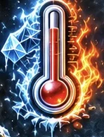
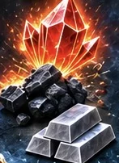
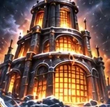
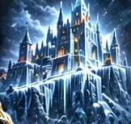
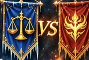
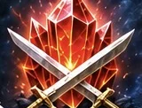
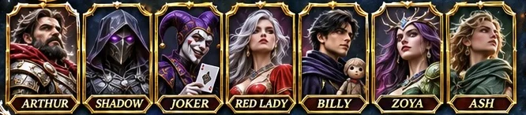

=== guide--en--strategy--frozen_era ===
---
layout: guides
title: "Frozen Era"
subtitle: "Season 2 survival guide"
active_nav: guides
guide_id: "frozen_era"
nav_links:
  - name_key: "frozen_era_temperature"
    url: "#temperature"
  - name_key: "frozen_era_resources"
    url: "#resources"
  - name_key: "frozen_era_buildings"
    url: "#buildings"
  - name_key: "frozen_era_realm"
    url: "#realm"
  - name_key: "frozen_era_factions"
    url: "#factions"
  - name_key: "frozen_era_war"
    url: "#war"
  - name_key: "frozen_era_heroes"
    url: "#heroes"
---

=== pane--en--strategy--frozen_era--01--temperature ===
---
title: "Temperature"
nav_id: "temperature"
parent_guide: "frozen_era"
lang: "en"
order: 1
---

Your territory's temperature changes your stats. Keep it high for bonus stats.

* **−20°C: Freeze countdown.** If the temperature isn't raised in time, the territory freezes: **Advanced Relocate** and **Rally** are disabled.
* **40°C: Burn countdown.** The territory catches fire and loses **Durability**. Put it out yourself or call your allies.
* **Icebreaking:** spend **Stamina** to send a squad to break the ice on a frozen target.
* **Heating:** send a **Scout Squad** to an ally's territory and spend **Charcoal** to warm them.
* **Blizzards** strike from time to time and lower the temperature of a whole region.

=== pane--en--strategy--frozen_era--02--resources ===
---
title: "Era Resources"
nav_id: "resources"
parent_guide: "frozen_era"
lang: "en"
order: 2
---

* **Fire Crystal:** the rare one. It heats your territory, and the final alliance and faction rankings are decided by the Fire Crystals held. Get them from cities, strongholds, Blazing Furnaces and the Faction Clash.
* **Charcoal:** builds the **Iron Mine Workshop** and boosts Iron output.
* **Iron Ore:** builds the **Blazing Furnace** (Temperature and RES).
* Hunting **Snow Realm monsters** drops large amounts of era resources.

> #### 💡 Spend them anyway
> Unused Charcoal and Iron Ore turn into **Lord's Specialty EXP** when the era ends, so nothing is wasted.

=== pane--en--strategy--frozen_era--03--buildings ===
---
title: "Furnaces & Buildings"
nav_id: "buildings"
parent_guide: "frozen_era"
lang: "en"
order: 3
---

* **Blazing Furnace:** raises Temperature and RES.
* **Iron Mine Workshop:** boosts Iron output.
* **Faction Pillar:** a bonus for your faction's heroes.
* **Alliance Furnace:** heats the zones around it. Overload it for more heat, at an extra Charcoal cost.

**RES** protects you from plague monsters. Attacking with low RES means heavy losses.

> #### ⚠️ Not for keeps
> All era buildings are removed when the era ends.

=== pane--en--strategy--frozen_era--04--realm ===
---
title: "The Snow Realm"
nav_id: "realm"
parent_guide: "frozen_era"
lang: "en"
order: 4
---

* When the era starts, alliances relocate together. The old cities are cleared and alliance homebases move to the outer zones.
* **Strongholds** are held by mutated behemoths. Clear them to restore Charcoal production.
* **Cities** heat the zone around them. Retake them from monster raids.
* The **Royal City** is sealed by ice: capture a **Lv. 6 city** first. The King is locked in until the first **Royal City Scramble**, and the King picks the kingdom's faction.

=== pane--en--strategy--frozen_era--05--factions ===
---
title: "Factions"
nav_id: "factions"
parent_guide: "frozen_era"
lang: "en"
order: 5
---

* **Order Alliance:** restore the old rule of the Royal City.
* **Nirvana Alliance:** burn down the old era and build a new world.

#### Faction Clash

* From **Monday to Saturday**, both factions score points, and the winner attacks.
* The battle is at the defenders' **Royal City**, and all eight servers can join.
* It lasts up to **4 hours**, and ends early at **100% occupation**.

=== pane--en--strategy--frozen_era--06--war ===
---
title: "Fire Crystal War"
nav_id: "war"
parent_guide: "frozen_era"
lang: "en"
order: 6
---

* **Tuesday and Friday:** declare war on an alliance with similar Fire Crystal rankings. Defenders can invite allies from the same faction with similar rankings.
* **Wednesday and Saturday:** the battles. Winners plunder Fire Crystals from the defender's furnace.

=== pane--en--strategy--frozen_era--07--heroes ===
---
title: "Hero Power-Ups"
nav_id: "heroes"
parent_guide: "frozen_era"
lang: "en"
order: 7
---

* **Awaken:** Arthur, Shadow, Joker
* **Exclusive Weapon:** Red Lady, Billy, Zoya
* **Promote:** Ash
* **Joins the Tavern:** Zoya, Louis, Ulfrid
* **Era damage buff against monsters:** Zoya, Red Lady, Joker, Ash
* **Era damage reduction against monsters:** Arthur, Shadow, Billy
* **Phantom city skin:** extra RES

> #### 🔥 Keep the fire. Hold the line.
