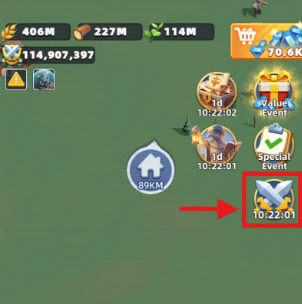
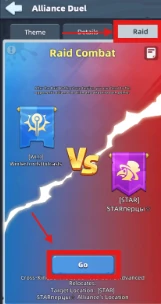
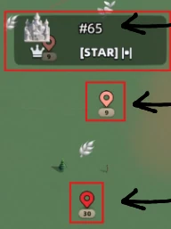
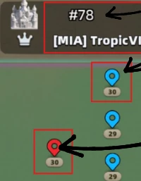
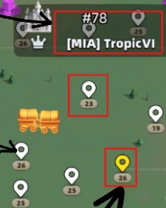

=== guide--en--events--kill_event ===
---
layout: guides
title: "Kill Event"
subtitle: "Raiding your Alliance Duel opponent"
active_nav: guides
guide_id: "kill_event"
nav_links:
  - name_key: "kill_event_travel"
    url: "#travel"
  - name_key: "kill_event_home"
    url: "#home"
  - name_key: "kill_event_targets"
    url: "#targets"
---

=== pane--en--events--kill_event--01--travel ===
---
title: "Getting There"
nav_id: "travel"
parent_guide: "kill_event"
lang: "en"
order: 1
---

The Kill Event is fought on the server of your **Alliance Duel** opponent. To get there:

1. Open the **Alliance Duel** event: its icon is on the right of your city view.
2. Go to the **Raid** tab.
3. Tap **Go**. You are teleported to the server your opponent is on.

=== pane--en--events--kill_event--02--home ===
---
title: "Getting Home"
nav_id: "home"
parent_guide: "kill_event"
lang: "en"
order: 2
---

The **blue arrow** next to the **!** at the top of the screen teleports you back to your own server.

> #### ⚠️ Teleport limit
> You can teleport to the enemy server **once every 5 minutes**.

=== pane--en--events--kill_event--03--targets ===
---
title: "Who to Hit"
nav_id: "targets"
parent_guide: "kill_event"
lang: "en"
order: 3
---

Every player on the map has a coloured marker. The banner at the top shows which server you are looking at.

#### On your opponent's server

*  **Bright red:** your opponent. Hit them.
*  **Light red:** a player from your opponent's server, but not your opponent.

#### On your home server

*  **Blue:** your own alliance. You can't hit them.
*  **White:** members of your server. Do **not** hit them.
*  **Red:** your opponent. Hit them.
*  **Yellow:** invading your server. Hit them if their location is shared.

=== guide--de--events--kill_event ===
---
layout: guides
title: "Kill Event"
subtitle: "Raiding your Alliance Duel opponent"
active_nav: guides
guide_id: "kill_event"
nav_links:
  - name_key: "kill_event_travel"
    url: "#travel"
  - name_key: "kill_event_home"
    url: "#home"
  - name_key: "kill_event_targets"
    url: "#targets"
---

=== pane--de--events--kill_event--01--travel ===
---
title: "Getting There"
nav_id: "travel"
parent_guide: "kill_event"
lang: "de"
order: 1
---

Das Kill Event wird auf dem Server deines **Allianz-Duell**-Gegners ausgetragen. So gelangst du dorthin:

1. Öffne das **Allianz-Duell**-Event: Das Symbol befindet sich auf der rechten Seite deiner Stadtansicht.
2. Gehe zum Tab **Überfall**.
3. Tippe auf **Los**. Du wirst zum Server deines Gegners teleportiert.

=== pane--de--events--kill_event--02--home ===
---
title: "Getting Home"
nav_id: "home"
parent_guide: "kill_event"
lang: "de"
order: 2
---

Der **blaue Pfeil** neben dem **!** oben auf dem Bildschirm teleportiert dich zurück auf deinen eigenen Server.

> #### ⚠️ Teleport-Limit
> Du kannst dich alle **5 Minuten einmal** zum gegnerischen Server teleportieren.

=== pane--de--events--kill_event--03--targets ===
---
title: "Who to Hit"
nav_id: "targets"
parent_guide: "kill_event"
lang: "de"
order: 3
---

Jeder Spieler auf der Karte hat eine farbige Markierung. Das Banner oben zeigt an, welchen Server du gerade betrachtest.

#### Auf dem Server deines Gegners

*  **Hellrot:** dein Gegner. Greife ihn an.
*  **Lichtrot:** ein Spieler vom Server deines Gegners, aber nicht dein Gegner.

#### Auf deinem Heimatserver

*  **Blau:** deine eigene Allianz. Du kannst sie nicht angreifen.
*  **Weiß:** Mitglieder deines Servers. Greife sie **nicht** an.
*  **Rot:** dein Gegner. Greife ihn an.
*  **Gelb:** dringt in deinen Server ein. Greife sie an, wenn ihr Standort geteilt wird.

=== guide--es--events--kill_event ===
---
layout: guides
title: "Evento de Kills"
subtitle: "Atacando a tu oponente en el Duelo de Alianzas"
active_nav: guides
guide_id: "kill_event"
nav_links:
  - name_key: "kill_event_travel"
    url: "#travel"
  - name_key: "kill_event_home"
    url: "#home"
  - name_key: "kill_event_targets"
    url: "#targets"
---

=== pane--es--events--kill_event--01--travel ===
---
title: "Cómo llegar"
nav_id: "travel"
parent_guide: "kill_event"
lang: "es"
order: 1
---

El Evento de Kills se libra en el servidor de tu oponente del **Duelo de Alianzas**. Para llegar allí:

1. Abre el evento **Duelo de Alianzas**: su icono se encuentra a la derecha de la vista de tu ciudad.
2. Ve a la pestaña **Incursión**.
3. Pulsa **Ir**. Serás teletransportado al servidor en el que se encuentra tu oponente.

=== pane--es--events--kill_event--02--home ===
---
title: "Cómo volver a casa"
nav_id: "home"
parent_guide: "kill_event"
lang: "es"
order: 2
---

La **flecha azul** junto al **!** en la parte superior de la pantalla te teletransporta de vuelta a tu propio servidor.

> #### ⚠️ Límite de teletransporte
> Puedes teletransportarte al servidor enemigo **una vez cada 5 minutos**.

=== pane--es--events--kill_event--03--targets ===
---
title: "A quién atacar"
nav_id: "targets"
parent_guide: "kill_event"
lang: "es"
order: 3
---

Cada jugador en el mapa tiene un marcador de color. El estandarte superior muestra qué servidor estás viendo.

#### En el servidor de tu oponente

*  **Rojo brillante:** tu oponente. Atácalos.
*  **Rojo claro:** un jugador del servidor de tu oponente, pero no es tu oponente.

#### En tu servidor local

*  **Azul:** tu propia alianza. No puedes atacarlos.
*  **Blanco:** miembros de tu servidor. **No** los ataques.
*  **Rojo:** tu oponente. Atácalos.
*  **Amarillo:** invadiendo tu servidor. Atácalos si su ubicación está compartida.

=== guide--fr--events--kill_event ===
---
layout: guides
title: "Événement de mise à mort"
subtitle: "Piller votre adversaire du Duel d'Alliances"
active_nav: guides
guide_id: "kill_event"
nav_links:
  - name_key: "kill_event_travel"
    url: "#travel"
  - name_key: "kill_event_home"
    url: "#home"
  - name_key: "kill_event_targets"
    url: "#targets"
---

=== pane--fr--events--kill_event--01--travel ===
---
title: "S'y rendre"
nav_id: "travel"
parent_guide: "kill_event"
lang: "fr"
order: 1
---

L'événement de mise à mort se déroule sur le serveur de votre adversaire du **Duel d'Alliances**. Pour vous y rendre :

1. Ouvrez l'événement **Duel d'Alliances** : son icône se trouve sur la droite de votre vue de ville.
2. Allez dans l'onglet **Raid**.
3. Appuyez sur **Aller**. Vous serez téléporté sur le serveur de votre adversaire.

=== pane--fr--events--kill_event--02--home ===
---
title: "Rentrer à la maison"
nav_id: "home"
parent_guide: "kill_event"
lang: "fr"
order: 2
---

La **flèche bleue** à côté du **!** en haut de l'écran vous téléporte sur votre propre serveur.

> #### ⚠️ Limite de téléportation
> Vous pouvez vous téléporter sur le serveur ennemi **une fois toutes les 5 minutes**.

=== pane--fr--events--kill_event--03--targets ===
---
title: "Qui attaquer"
nav_id: "targets"
parent_guide: "kill_event"
lang: "fr"
order: 3
---

Chaque joueur sur la carte possède un marqueur coloré. La bannière en haut indique quel serveur vous consultez.

#### Sur le serveur de votre adversaire

*  **Rouge vif :** votre adversaire. Attaquez-le.
*  **Rouge clair :** un joueur du serveur de votre adversaire, mais ce n'est pas votre adversaire.

#### Sur votre serveur d'origine

*  **Bleu :** votre propre alliance. Vous ne pouvez pas les attaquer.
*  **Blanc :** membres de votre serveur. Ne les attaquez **pas**.
*  **Rouge :** votre adversaire. Attaquez-le.
*  **Jaune :** envahisseur sur votre serveur. Attaquez-le si sa position est partagée.

=== guide--ru--events--kill_event ===
---
layout: guides
title: "Kill Event"
subtitle: "Нападение на противника в Дуэли Альянсов"
active_nav: guides
guide_id: "kill_event"
nav_links:
  - name_key: "kill_event_travel"
    url: "#travel"
  - name_key: "kill_event_home"
    url: "#home"
  - name_key: "kill_event_targets"
    url: "#targets"
---

=== pane--ru--events--kill_event--01--travel ===
---
title: "Как попасть на сервер врага"
nav_id: "travel"
parent_guide: "kill_event"
lang: "ru"
order: 1
---

Событие «Kill Event» проходит на сервере вашего противника по **Дуэли Альянсов**. Чтобы попасть туда:

1. Откройте событие **Дуэль Альянсов**: его иконка находится справа в режиме обзора города.
2. Перейдите во вкладку **Рейд**.
3. Нажмите **Перейти**. Вы будете телепортированы на сервер, где находится ваш противник.

=== pane--ru--events--kill_event--02--home ===
---
title: "Как вернуться домой"
nav_id: "home"
parent_guide: "kill_event"
lang: "ru"
order: 2
---

**Синяя стрелка** рядом с символом **!** в верхней части экрана телепортирует вас обратно на ваш родной сервер.

> #### ⚠️ Лимит телепортации
> Вы можете телепортироваться на сервер врага **не чаще одного раза в 5 минут**.

=== pane--ru--events--kill_event--03--targets ===
---
title: "Кого атаковать"
nav_id: "targets"
parent_guide: "kill_event"
lang: "ru"
order: 3
---

Каждый игрок на карте имеет цветной маркер. Баннер в верхней части экрана показывает, сервер какого противника вы просматриваете.

#### На сервере противника

*  **Ярко-красный:** ваш противник. Атакуйте его.
*  **Светло-красный:** игрок с сервера вашего противника, но не ваша цель.

#### На вашем родном сервере

*  **Синий:** ваш альянс. Вы не можете атаковать их.
*  **Белый:** участники вашего сервера. **Не** атакуйте их.
*  **Красный:** ваш противник. Атакуйте его.
*  **Желтый:** захватчики вашего сервера. Атакуйте их, если их местоположение раскрыто.

=== guide--tr--events--kill_event ===
---
layout: guides
title: "Öldürme Etkinliği"
subtitle: "İttifak Düellosu rakibine baskın yapmak"
active_nav: guides
guide_id: "kill_event"
nav_links:
  - name_key: "kill_event_travel"
    url: "#travel"
  - name_key: "kill_event_home"
    url: "#home"
  - name_key: "kill_event_targets"
    url: "#targets"
---

=== pane--tr--events--kill_event--01--travel ===
---
title: "Oraya Gitme"
nav_id: "travel"
parent_guide: "kill_event"
lang: "tr"
order: 1
---

Öldürme Etkinliği, **İttifak Düellosu** rakibinizin sunucusunda yapılır. Oraya gitmek için:

1. **İttifak Düellosu** etkinliğini açın: simgesi şehir görünümünüzün sağ tarafındadır.
2. **Baskın** sekmesine gidin.
3. **Git** düğmesine dokunun. Rakibinizin bulunduğu sunucuya ışınlanacaksınız.

=== pane--tr--events--kill_event--02--home ===
---
title: "Eve Dönüş"
nav_id: "home"
parent_guide: "kill_event"
lang: "tr"
order: 2
---

Ekranın üst kısmındaki **!** işaretinin yanındaki **mavi ok**, sizi kendi sunucunuza geri ışınlar.

> #### ⚠️ Işınlanma sınırı
> Düşman sunucusuna **her 5 dakikada bir** ışınlanabilirsiniz.

=== pane--tr--events--kill_event--03--targets ===
---
title: "Kimi Vurmalı"
nav_id: "targets"
parent_guide: "kill_event"
lang: "tr"
order: 3
---

Haritadaki her oyuncunun renkli bir işaretçisi vardır. Üstteki başlık, hangi sunucuya baktığınızı gösterir.

#### Rakibinizin sunucusunda

*  **Parlak kırmızı:** rakibiniz. Onları vurun.
*  **Açık kırmızı:** rakibinizin sunucusundan bir oyuncu, ancak rakibiniz değil.

#### Kendi sunucunuzda

*  **Mavi:** kendi ittifakınız. Onları vuramazsınız.
*  **Beyaz:** sunucunuzdaki üyeler. Onları **vurmayın**.
*  **Kırmızı:** rakibiniz. Onları vurun.
*  **Sarı:** sunucunuzu istila edenler. Konumları paylaşılmışsa onları vurun.

=== guide--uk--events--kill_event ===
---
layout: guides
title: "Kill Event"
subtitle: "Raiding your Alliance Duel opponent"
active_nav: guides
guide_id: "kill_event"
nav_links:
  - name_key: "kill_event_travel"
    url: "#travel"
  - name_key: "kill_event_home"
    url: "#home"
  - name_key: "kill_event_targets"
    url: "#targets"
---

=== pane--uk--events--kill_event--01--travel ===
---
title: "Getting There"
nav_id: "travel"
parent_guide: "kill_event"
lang: "uk"
order: 1
---

Kill Event (Подія вбивства) відбувається на сервері вашого суперника по **Дуелі Альянсів**. Щоб потрапити туди:

1. Відкрийте подію **Дуель Альянсів**: її іконка знаходиться праворуч від вигляду вашого міста.
2. Перейдіть на вкладку **Рейд**.
3. Натисніть **Йти**. Вас буде телепортовано на сервер, де знаходиться ваш суперник.

=== pane--uk--events--kill_event--02--home ===
---
title: "Getting Home"
nav_id: "home"
parent_guide: "kill_event"
lang: "uk"
order: 2
---

**Синя стрілка** поруч із символом **!** у верхній частині екрана телепортує вас назад на ваш власний сервер.

> #### ⚠️ Ліміт телепортації
> Ви можете телепортуватися на сервер ворога **раз на 5 хвилин**.

=== pane--uk--events--kill_event--03--targets ===
---
title: "Who to Hit"
nav_id: "targets"
parent_guide: "kill_event"
lang: "uk"
order: 3
---

Кожен гравець на карті має кольорову позначку. Банер у верхній частині показує, який сервер ви зараз переглядаєте.

#### На сервері вашого суперника

*  **Яскраво-червоний:** ваш суперник. Атакуйте його.
*  **Світло-червоний:** гравець із сервера вашого суперника, але не ваш безпосередній опонент.

#### На вашому домашньому сервері

*  **Синій:** ваш власний альянс. Ви не можете їх атакувати.
*  **Білий:** учасники вашого сервера. **Не** атакуйте їх.
*  **Червоний:** ваш суперник. Атакуйте його.
*  **Жовтий:** загарбники на вашому сервері. Атакуйте їх, якщо їхнє місцезнаходження відкрите.

=== guide--it--events--kill_event ===
---
layout: guides
title: "Evento Uccisioni"
subtitle: "Attaccare l'avversario del Duello tra Alleanze"
active_nav: guides
guide_id: "kill_event"
nav_links:
  - name_key: "kill_event_travel"
    url: "#travel"
  - name_key: "kill_event_home"
    url: "#home"
  - name_key: "kill_event_targets"
    url: "#targets"
---

=== pane--it--events--kill_event--01--travel ===
---
title: "Come arrivare"
nav_id: "travel"
parent_guide: "kill_event"
lang: "it"
order: 1
---

L'Evento Uccisioni si svolge sul server del tuo avversario nel **Duello tra Alleanze**. Per arrivarci:

1. Apri l'evento **Duello tra Alleanze**: l'icona si trova sulla destra nella vista della tua città.
2. Vai sulla scheda **Incursione**.
3. Tocca **Vai**. Sarai teletrasportato sul server in cui si trova il tuo avversario.

=== pane--it--events--kill_event--02--home ===
---
title: "Come tornare a casa"
nav_id: "home"
parent_guide: "kill_event"
lang: "it"
order: 2
---

La **freccia blu** accanto al punto esclamativo **!** in cima allo schermo ti teletrasporta indietro al tuo server.

> #### ⚠️ Limite di teletrasporto
> Puoi teletrasportarti sul server nemico **una volta ogni 5 minuti**.

=== pane--it--events--kill_event--03--targets ===
---
title: "Chi attaccare"
nav_id: "targets"
parent_guide: "kill_event"
lang: "it"
order: 3
---

Ogni giocatore sulla mappa ha un indicatore colorato. Il banner in alto mostra su quale server ti trovi.

#### Sul server del tuo avversario

*  **Rosso brillante:** il tuo avversario. Attaccalo.
*  **Rosso chiaro:** un giocatore del server del tuo avversario, ma non il tuo avversario.

#### Sul tuo server

*  **Blu:** la tua alleanza. Non puoi attaccarli.
*  **Bianco:** membri del tuo server. **Non** attaccarli.
*  **Rosso:** il tuo avversario. Attaccalo.
*  **Giallo:** invasori del tuo server. Attaccali se la loro posizione è condivisa.

