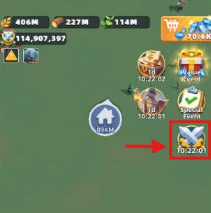
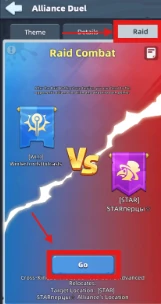
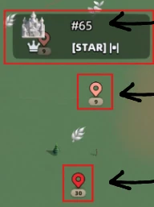
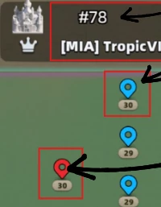
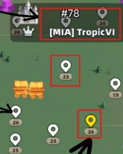

=== guide--en--events--kill_event ===
---
layout: guides
title: "Kill Event"
subtitle: "Raiding your Alliance Duel opponent"
active_nav: guides
guide_id: "kill_event"
nav_links:
  - name_key: "kill_event_travel"
    url: "#travel"
  - name_key: "kill_event_home"
    url: "#home"
  - name_key: "kill_event_targets"
    url: "#targets"
---

=== pane--en--events--kill_event--01--travel ===
---
title: "Getting There"
nav_id: "travel"
parent_guide: "kill_event"
lang: "en"
order: 1
---

The Kill Event is fought on the server of your **Alliance Duel** opponent. To get there:

1. Open the **Alliance Duel** event: its icon is on the right of your city view.
2. Go to the **Raid** tab.
3. Tap **Go**. You are teleported to the server your opponent is on.

=== pane--en--events--kill_event--02--home ===
---
title: "Getting Home"
nav_id: "home"
parent_guide: "kill_event"
lang: "en"
order: 2
---

The **blue arrow** next to the **!** at the top of the screen teleports you back to your own server.

> #### ⚠️ Teleport limit
> You can teleport to the enemy server **once every 5 minutes**.

=== pane--en--events--kill_event--03--targets ===
---
title: "Who to Hit"
nav_id: "targets"
parent_guide: "kill_event"
lang: "en"
order: 3
---

Every player on the map has a coloured marker. The banner at the top shows which server you are looking at.

#### On your opponent's server

*  **Bright red:** your opponent. Hit them.
*  **Light red:** a player from your opponent's server, but not your opponent.

#### On your home server

*  **Blue:** your own alliance. You can't hit them.
*  **White:** members of your server. Do **not** hit them.
*  **Red:** your opponent. Hit them.
*  **Yellow:** invading your server. Hit them if their location is shared.

